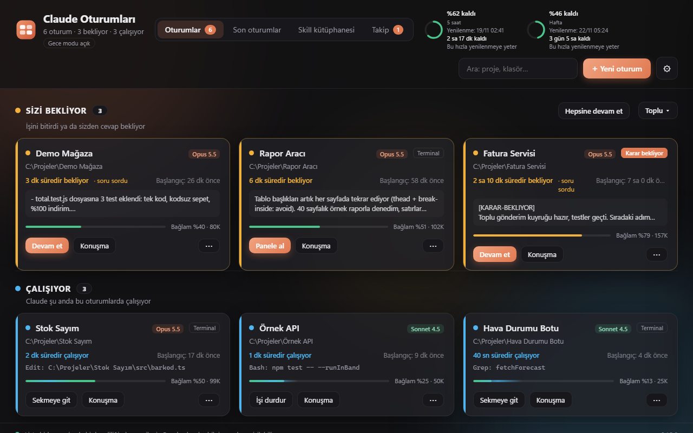
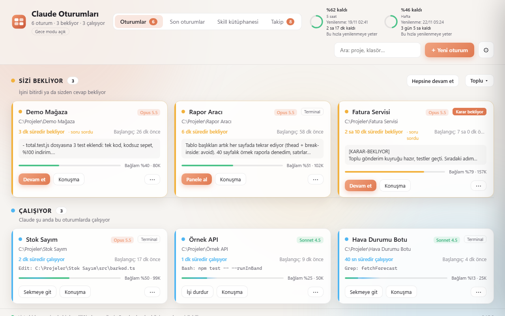
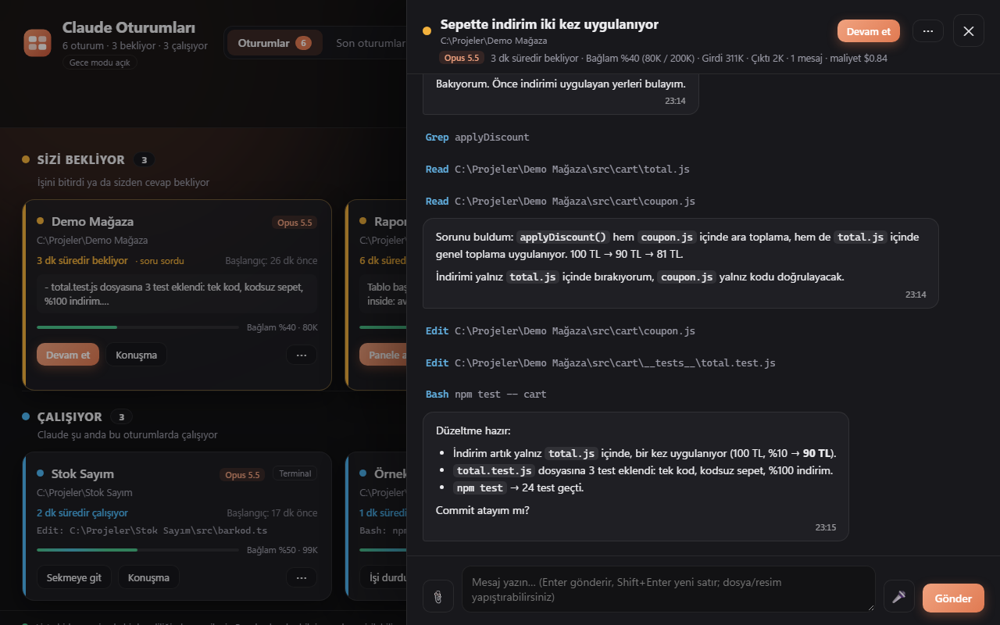
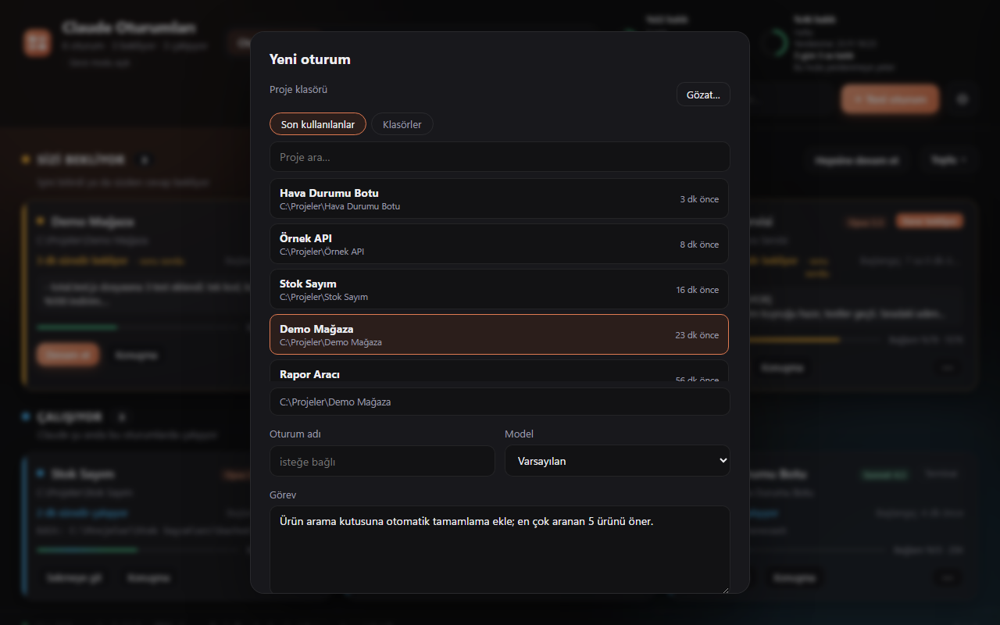
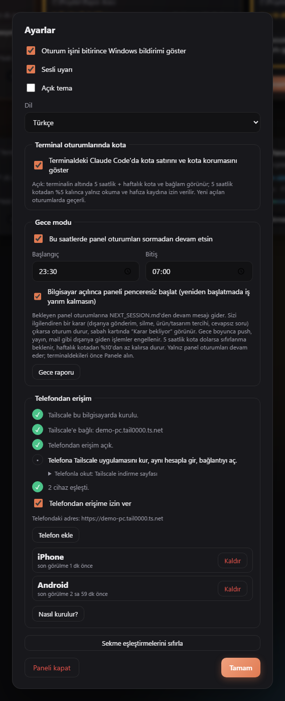
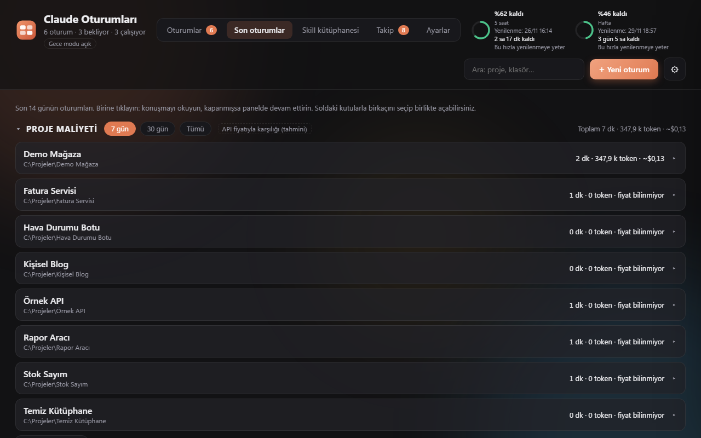
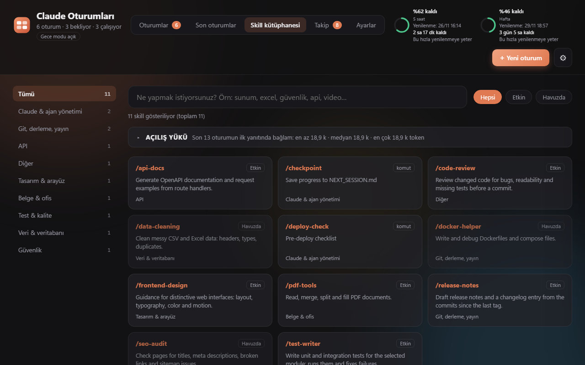
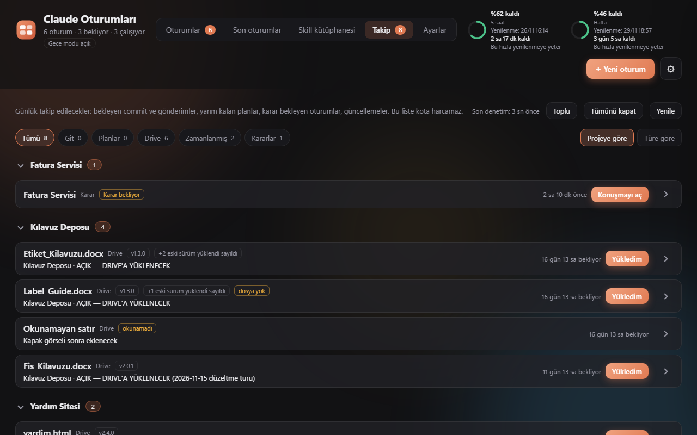
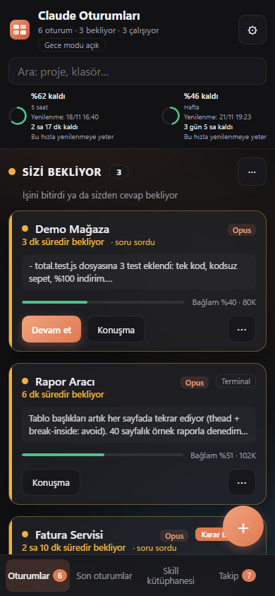
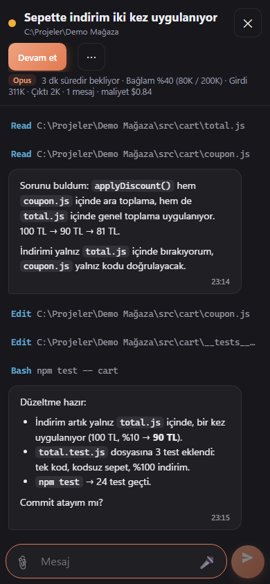

**English** | [Türkçe](README.tr.md)

# Claude Session Panel (Claude Oturum Paneli)

A small app that shows every Claude Code session running on your computer on one screen. Works on Windows and macOS.
Double-click it and a window without an address bar opens; behind it runs a tiny web server that only this computer
can reach (`127.0.0.1`).



> All projects, sessions and paths in the screenshots are made up (demo data). The UI is shown in Turkish; it also has an English mode (Settings → Language).

## Features

### Sessions

- Sessions are shown in two lanes: **Waiting for you** (finished, or waiting for your answer) and **Working**.
- Each card shows the folder, how long the session has been waiting or working, and when it started.
- **Model and context**: a model badge on the card, a context-usage bar (the window size is learned from the session's result record or from the statusline), the last lines of the latest reply, and the current tool while it works. The conversation header shows input/output tokens, message and compaction counts, and cost.
- **Go to window**: brings the session's terminal window to the front.
- **Go to tab**: picks the right tab in Windows Terminal (the tab title is matched against the folder name; if there's no match it asks once and remembers your choice).
- A Windows notification and a sound when a session finishes.
- Search (`/`), new session (`N`), light/dark theme, Turkish/English.



### Conversations and panel sessions

- **Conversation drawer** (click a card): the session's messages and tool steps stream in live.
- **Sessions inside the panel**: a new session can run inside the panel (`claude -p --input-format stream-json`). You type messages here, stop the current job, or close the session. Write to a closed session and it picks up where it left off with `--resume`.
- **Save and clear / Save and close** (panel sessions): the session first saves its state (`/smart-clear` if you have it, otherwise a message asking it to update CLAUDE_MEMORY.md + NEXT_SESSION.md). "Clear" then continues in a fresh context with `/clear` + `devam` ("continue"); "close" shuts it down. Each card has a primary button that depends on its state (Continue / Save and clear / Move here) plus a ⋯ menu; a working session can be told to "continue / clear / close when done". **Bulk ▾ → Select…** in the lane header (or Ctrl + click) applies an action to the selected sessions (terminal sessions can be selected too, and bulk **Move here** moves them into the panel); the "All …" options live in the same menu.



### New session

- **New session**: pick a folder, describe the task, and it starts in the background with `claude --bg` (or inside the panel).



### Quota

- **Quota**: rings for the 5-hour and weekly quota, time left until each resets, and an "at this pace" estimate. The panel reads the quota on its own (Anthropic usage API; credentials come from `~/.claude/.credentials.json` on Windows and the Keychain on macOS), so no statusline script is needed.
- **Quota guard**: in sessions started by the panel, once 5% of the 5-hour quota is left only reading and saving memory (CLAUDE_MEMORY.md / NEXT_SESSION.md) are allowed, so you don't slide into paid extra usage (`ClaudePanel --quota-guard`, passed with `--settings`; skipped if you already have your own `quota-guard` hook).
- **Quota in the terminal** (Settings, off by default): a plan, quota and context line under Claude Code in the terminal (`ClaudePanel --statusline`) plus the same quota guard. It is written to `~/.claude/settings.json`; your current status line is backed up and restored when you untick the box. No Python needed.

### Night mode and restarts

- **Night mode**: during the hours you set, waiting panel sessions continue from NEXT_SESSION.md without asking. If a decision that needs you comes up, the session stops and its card says "Needs decision". The panel's own hook (passed to panel sessions with `--settings`, works on macOS too) tries to block anything that leaves the machine (push, publish, mail, writes to GitHub, sending data with curl/wget/PowerShell, ssh/scp/rsync). This is a **best-effort** measure: it is a deny list that looks at the command text and can't catch every path (for example a request made from inside a script file). The real protection is Claude Code's permission settings (`settings.json` → `permissions.deny` / `ask`); block what must not leave the machine there too. If the guard file can't be read, the hook fails closed and blocks the risky action. If the quota runs out, it waits for the reset. In the morning: Settings → Night report.
- **Start when the computer starts** (Windows: Run key, macOS: LaunchAgent): after a restart the panel opens without a window, reattaches the sessions and resumes interrupted work. During the night window the computer doesn't go to sleep while idle (Windows `SetThreadExecutionState`, macOS `caffeinate`).



### Recent sessions

- **Recent sessions**: conversations from the last 14 days; open them, read them, continue them.



### Skill library

- **Skill library**: active skills, skills in your pool and plugin skills, with their descriptions; click a name to copy its `/command` to the clipboard.



### Follow-up

- **Follow-up**: the things to keep an eye on every day, in one tab, without spending any quota. **Git**: uncommitted files and unpushed commits in the repositories of the projects Claude has worked in (no `git fetch`; clean repositories are only counted). One button per repository: "Commit", "Push" or "Commit and push" (plus "Commit and push all"). These don't open a session card: "Push" is a plain `git push` by the panel after checking the outgoing commits for secrets (a permissions file, `.env`, a token pattern stops the push and the row says why, without showing the value); "Commit" runs as a hidden background job and only turns into a visible session when your decision is needed. Projects that already have an open session are hidden here. The list is grouped by project (or split by type); groups collapse, and the filter chips and the view are remembered. Rows can be snoozed until tomorrow or hidden until their state changes; the "Bulk" menu at the top acts on several items at once. **Up next**: `NEXT_SESSION.md` files in project folders, with a short summary and their age (older than 3 days is marked "old plan"), and a "Continue" button. **Waiting for a decision**: sessions that stopped at a decision during night mode. **To upload to Drive**: files still listed as open in the `GUNCELLEME_KUTUGU.md` update ledgers of your project folders (with version and waiting time; when a document is listed in several versions only the newest is shown and the older ones count as uploaded); "Uploaded" is a local mark, "Close in ledger" has a background session update the ledger (the panel never writes to it). **Scheduled work**: tasks in the computer's scheduler (Windows Task Scheduler, macOS LaunchAgents) that relate to your projects (next / last run, last result; "Show in folder" and "Disable" with confirmation, from the computer only), Claude task files (existence and date only), recurring work in open sessions (`/loop`, scheduled tasks: duration, tokens used, warnings for idle rounds in a row and for low quota; "Stop" with confirmation sends a message to the panel session), a link to cloud routines and promises (`TAKİP: YYYY-MM-DD — text` lines in `NEXT_SESSION.md`; overdue ones in red and first). The panel never stops anything on its own. **Planned jobs** (same section, "Plan"): at the chosen time (once, every day, weekdays) the panel opens a visible session in a project, does the work in a separate working copy (`panel/` branch, no push) and leaves it for your review ("Review", "Merge", "Discard"), or starts the 5-hour quota window early with a very short Haiku request. If a session is open in the project or quota is low it is retried for 3 hours; jobs don't run while the panel is closed, and the computer is kept awake 12 hours before a job. **Updates**: a new panel version is shown with a link to its release page (the panel doesn't update itself). When a new Claude Code version appears, the panel runs `claude update` itself in the background (once per version; a failed attempt is retried after 6 hours) and shows "Updating…", then "installed; new sessions use it" or the error; "Update now" runs it on demand. Open sessions keep the version they started with. The tab title shows how many items are pending.
- **One session per project**: starting a session in a project (git root, subfolders included) that already has one doesn't silently open a second one. The panel asks: send to the open session, send when it finishes, open in a separate working copy (`git worktree`, sibling folder), or open anyway. Session cards show "N sessions open in this project", and a hook holds back file writes and `git commit/push` in a session while another one that started earlier is working in the same project.



### Phone access

- **Phone access** (optional, off by default): open the panel from an iPhone or Android phone over Tailscale's encrypted private network. No port is opened to the internet, and every phone is paired with a QR code. Setup is in the panel: Settings → Phone access → **How to set up?**
- **Reaching the computer's desktop from your phone** (not part of the panel, but uses the same Tailscale connection): Remote Desktop + Windows App on Windows, Screen Sharing + a VNC app on macOS. Step-by-step guide with screenshots (in Turkish): [docs/uzak-masaustu.md](docs/uzak-masaustu.md).

<p>
  
  
</p>

## Installation

Download: [latest release](https://github.com/ahmetunaluzun/claude-oturum-paneli/releases/latest). Claude Code must be installed and signed in; the panel doesn't need an account of its own.
To verify a download, use `SHA256SUMS` (Windows: `Get-FileHash <zip>`, macOS: `shasum -a 256 <zip>`).

### Windows

Unzip `ClaudePanel-<version>-win-x64.zip` and run `ClaudePanel.exe`. Requirements: Windows 10/11, the [.NET 10 runtime](https://dotnet.microsoft.com/download/dotnet/10.0) (ASP.NET Core Runtime), and Edge or Chrome (for the window).

### macOS

1. Run `uname -m` in Terminal: if it says `arm64`, take `ClaudePanel-<version>-osx-arm64.zip` (Apple Silicon); if it says `x86_64`, take `osx-x64` (Intel).
2. Download the zip and double-click to extract it.
3. First launch (the build is made on Windows and is unsigned):

```
cd <folder>
xattr -dr com.apple.quarantine . 2>/dev/null; chmod +x ClaudePanel
codesign --force --sign - ClaudePanel      # required on Apple Silicon (ad-hoc signature)
codesign --force --sign - runtimes/*/*.dylib   # voice dictation libraries
./ClaudePanel
```

Requirements: Chrome, Edge, Brave or Chromium (otherwise it opens in your default browser) and `claude` installed
(`~/.local/bin/claude`, Homebrew or on PATH). Differences on macOS:
- **Go to tab** works in iTerm2 and Terminal; the tab is matched exactly through the tty of the claude process. The first time,
  macOS asks for "Automation" permission (System Settings → Privacy & Security → Automation).
- There's no menu bar icon; you get a macOS notification when a session finishes. To quit: Settings → Quit panel.
- Voice dictation uses Metal on Apple Silicon and the CPU on Intel Macs (macOS libraries of the Whisper.net package); its speed hasn't been measured on a Mac.
- During the night window `caffeinate` prevents idle sleep; closing the lid still puts the Mac to sleep.
- Folder picking and the clipboard (files copied with ⌘C in Finder, screenshots) go through AppleScript.
- The macOS build is compiled on Windows and hasn't been tried on a real Mac yet.

### Usage notes

The default port is `8790`; set the `CLAUDE_PANEL_PORT` environment variable to change it.
Clicking the exe again while the panel is running just opens the window.
To quit: Settings → Quit panel.

## Updating

- **Computer (Windows):** put the new `ClaudePanel.exe` in the same place. If the running panel is older, the new exe asks "New version ready" when it starts; confirm and it closes the old one and takes over. Sessions in the panel come back where they were.
- **macOS:** download the new package and extract it over the old folder. The first-launch steps (`xattr`, `codesign`) are needed again for every new package.
- **Phone:** nothing to update. The panel on your phone (a browser tab or an app added to the home screen) is just the page served by your computer's panel; it isn't cached and comes from the computer every time it opens. After the computer moves to a new version, reload the page or close and reopen the app; there's no need to remove and re-add it.
- **Phones paired before 0.9.1 (one time):** the old device cookie wasn't sent when opening from the home-screen app. Once the computer is on 0.9.1+, open the panel once **in a browser tab** on the phone (this refreshes the cookie), then open it from the app. If it still asks for a code, pair once inside the app.

## How it works

Claude Code keeps a `~/.claude/sessions/<pid>.json` file for each session (status: `busy`, `idle`, `shell`).
The panel reads these files every 2.5 seconds and checks, using the start time, that the process is still the same one.
It doesn't touch Claude or change any settings.

## Security

- The server binds to `127.0.0.1` only; requests with any other `Host` header are rejected.
- Every request that changes something needs a random key generated at each start and must come from the same origin.
- The new-session command doesn't go through a shell (`ArgumentList`); the folder must exist.
- No fonts, libraries or analytics are loaded from external servers.
- **Update check (0.11.0):** at most once every 6 hours the panel makes one anonymous request each to `api.github.com` (latest panel release) and `registry.npmjs.org` (latest Claude Code version); the answer is stored in the panel's data folder. The only other outbound request is reading the quota (Anthropic usage API).
- **Phone access (0.7.0, off by default):** when turned on, this machine's Tailscale name (`*.ts.net`) is accepted as well, and nothing else. Every request from that name needs a paired-device cookie; pairing is started from the panel on the computer (one-time code, 5 minutes, 5 wrong attempts). Endpoints that act on the computer's screen or clipboard are disabled from the phone. Test: `bash tools/remote_guvenlik_testi.sh` (against a test copy started on 8791 with `CLAUDE_PANEL_REMOTE_HOST=test.ts.net`).

## Building

The project builds for two targets: `net10.0-windows` (Windows) and `net10.0` (macOS). Platform-specific code lives in
`src/ClaudePanel/Platform/Windows` and `Platform/Mac`; the class names are the same and the target decides which one is compiled.

**Windows**

```
dotnet publish src/ClaudePanel -c Release -f net10.0-windows -o dist
dist\ClaudePanel.exe
```

Requirements: Windows 10/11, the .NET 10 runtime, Edge or Chrome (for the window).

**macOS** (can also be built on Windows; the runtime is bundled)

```
dotnet publish src/ClaudePanel -c Release -f net10.0 -r osx-arm64 --self-contained true -o dist-mac/osx-arm64
```

Use `osx-x64` for Intel Macs. Then keep only `macos-arm64` (or `macos-x64`) under `runtimes/`, delete the `.pdb` files and zip it with `python tools/mac_zip.py <version>` (paths with `/`, `ClaudePanel` 0755). First-launch steps on a Mac are above, under [macOS](#macos).

**Regenerating the screenshots:** `pwsh -File tools\readme_gorsel_uret.ps1` (builds `docs/img/*.png` from a made-up `.claude` folder and a test copy of the panel; your real sessions and settings are not touched).

## Known limitations

- On Windows, the tab is found by its title in Windows Terminal; if two tabs share a title, the first one is picked.
- Work in progress is interrupted when the panel closes; sessions are reattached when the panel opens again (0.4.0), and the ones that were working get a "continue" message (0.6.0).
- Night mode only continues panel sessions; terminal sessions must be moved to the panel first. If Windows restarts after an update, you need to sign in to Windows for the panel to start (Settings → Accounts → Sign-in options → "Use my sign-in info to automatically finish setting up after an update").
- The `idle` status doesn't distinguish "finished" from "waiting for permission".
- The `sessions/*.json` format is an internal Claude Code file; it may need adjusting when Claude Code changes.

## License

MIT — see [LICENSE](LICENSE). This is an independent project; it is not made or endorsed by Anthropic.

## Version history

The detailed changelog is in Turkish: [CHANGELOG.md](CHANGELOG.md).

| Version | Date | Area | Before | After | Why |
|---|---|---|---|---|---|
| 0.16.0 | 2026-11-19 | Follow-up: planned jobs | The panel couldn't start work at a set time | "Plan" in the Scheduled work section: at the chosen time (once, every day, weekdays) it opens a session, does the work in a separate working copy and leaves it for your review (Review / Merge / Discard), or starts the 5-hour quota window early; retried for 3 hours if a session is open or quota is low | Running work while away from the computer, with you keeping control |
| 0.15.1 | 2026-11-19 | Follow-up: to upload to Drive | Every open version of a document was a separate row (e.g. 1.2.0, 1.2.1, 1.3.0 of the same guide) | Only the newest version is listed; older ones count as uploaded ("+N older versions" tag) and "Close in ledger" closes them too | Only the version that actually needs uploading is shown |
| 0.15.0 | 2026-11-19 | Follow-up: Claude Code update | New Claude Code versions were only reported ("update with claude update") | The panel runs `claude update` itself when a new version appears (once per version, retried after 6 hours on failure), shows progress and the result; "Update now" button | Claude Code stays current without a manual step |
| 0.14.0 | 2026-11-19 | Follow-up: scheduled work | Scheduler tasks, recurring work in open sessions (`/loop`, cron) and promises weren't visible in the panel | A "Scheduled work" section: Task Scheduler / LaunchAgent tasks (project, next / last run, result; Show in folder, Disable with confirmation, computer only), Claude task files (existence + date only), recurring work in open sessions (duration, tokens, idle-round and low-quota warnings, Stop with confirmation), a link to cloud routines | Seeing background work that runs and uses quota in one place; the panel never stops anything on its own |
| 0.14.0 | 2026-11-19 | Follow-up: promises | Promises like "I'll check tomorrow" were forgotten once the session closed | `TAKİP: YYYY-MM-DD — text` lines in `NEXT_SESSION.md` show in Follow-up; overdue ones in red and first. "Save and close" and night-mode prompts make the session write its promises in this format | Being reminded of a promise when its date comes |
| 0.13.0 | 2026-11-19 | Follow-up: to upload to Drive | Open Drive entries in update ledgers (`GUNCELLEME_KUTUGU.md`) weren't visible in the panel | Files listed as still to be uploaded: project, file, version, waiting time; "Uploaded" (local mark, comes back if the file changes), "Show in folder", "Close in ledger" (a background session updates the ledger) | Files waiting to be uploaded don't get forgotten |
| 0.13.0 | 2026-11-19 | Follow-up: list | Sections by type only; items couldn't be snoozed or hidden | Grouped by project (default) or by type; filter chips with counts; "Snooze (tomorrow)" and "Hide" on each row; a "new" mark on items that just appeared; compact rows that expand on click | Put what matters first in a long list, less scrolling |
| 0.13.0 | 2026-11-19 | Follow-up: bulk actions | "Commit and push all" only showed while the Git section was expanded | A "Bulk" menu at the top: commit and push all pending repositories; select items to commit and push, snooze, hide or mark as uploaded | Bulk actions are reachable while sections are collapsed |
| 0.12.1 | 2026-11-18 | Session card: "N sessions open in this project" | Information text only | Tap to get "Save and close", "Move here", "Open conversation" for the sessions in that project | Resolve the conflict right from the card |
| 0.12.1 | 2026-11-18 | Conflict dialog (terminal session) | A reminder to move the terminal session from the Sessions tab | First option "Move here and send": the terminal session is moved to the panel and the request is written to it | Continue in the same conversation instead of opening a second session |
| 0.12.0 | 2026-11-18 | Follow-up: commit / push | Separate "Commit" and "Push" buttons, each opening a visible panel session (pressing both opened two sessions in one repository) | One button per repository ("Commit" / "Push" / "Commit and push") and "Commit and push all"; no session card: push is done by the panel after a secret check, commit runs as a hidden background job | Two sessions were opened in the same repository; commit/push shouldn't clutter the session list |
| 0.12.0 | 2026-11-18 | Same project, several sessions | A different request to the same folder always opened another session | The panel asks (send to the open session / send when it finishes / separate working copy / open anyway); badge on cards; a hook holds back writes while an earlier session is working | Two sessions writing to the same files break each other's work |
| 0.12.0 | 2026-11-18 | Follow-up: layout | All sections always expanded; projects with an open session listed too | Collapsible sections (remembered), "Expand/Collapse all"; projects open in a session are hidden with a one-line note | Less scrolling; the open session already handles that project |
| 0.11.1 | 2026-11-18 | License | No license file | MIT license (LICENSE) and this section | The repository is public; terms of use had to be stated |
| 0.11.1 | 2026-11-18 | Confirmation dialogs | Browser's built-in confirm box (not shown in the macOS app window) | The panel's own dialog: title, clear action button, red for destructive actions | Confirmations were invisible on macOS |
| 0.11.0 | 2026-11-18 | README | Turkish only, no screenshots | README.md in English, README.tr.md in Turkish; screenshots with made-up data; installation section | User request: the repository is public, it needs a bilingual introduction with images |
| 0.11.0 | 2026-11-18 | Follow-up tab | Pending commits/pushes, unfinished plans and updates weren't visible in one place | Follow-up tab: Git, Up next, Waiting for a decision, Updates; start a panel session from a row | User request: a separate tab for the daily to-dos |
| 0.11.0 | 2026-11-18 | Starting sessions | When the response was slow, pressing Start repeatedly opened the same session several times | The button is locked while the request runs; the server won't start the same request twice within 20 s; start-up time is logged | The same session was opened 5 times in real use |
| 0.11.0 | 2026-11-18 | Security | Only outbound request was reading usage | + update check (GitHub, npm; every 6 hours, anonymous) | Updates section |
| 0.10.1 | 2026-11-18 | Exe icon | Default Windows icon | App icon | Appearance |
| 0.10.0 | 2026-11-18 | Usage | The usage cache was written only by the user's own statusline script | The panel reads usage itself; usage guard; usage line in the terminal (Settings) | Usage rings stayed empty on other computers |
| 0.9.2 | 2026-11-18 | Settings → Phone access (computer) | If a library failed to load during an update: permanent 500, empty section | Libraries load at start; a QR-code error isn't permanent | A paired phone didn't show up in the panel |
| 0.9.2 | 2026-11-18 | Clicking a notification / the tray icon | A new panel window every time | The open window comes to the front | User request |
| 0.9.2 | 2026-11-18 | Version comparison | "New version ready" was asked for the same version | 3-part comparison | Bug |
| 0.9.1 | 2026-11-18 | Device cookie | `SameSite=Strict` | `SameSite=Lax` (refreshed when the page opens) | Opening from the home-screen app didn't send the cookie, pairing was requested again |
| 0.9.1 | 2026-11-18 | Settings → Phone access on the phone | Only "This device is paired" | Status, address, paired devices (read-only, this device marked) | User request: see what's active from the phone too |
| 0.9.0 | 2026-11-18 | Start at login on macOS | Not on macOS (box hidden) | LaunchAgent plist (`--no-window`, with PATH) | User request: what's needed for macOS |
| 0.9.0 | 2026-11-18 | Sleep in night mode | Not prevented (Windows + macOS) | Idle sleep is prevented during the night window | Night work stopped if the computer slept |
| 0.9.0 | 2026-11-18 | Night guard | `~/.claude/hooks/gece-modu-koruma.py` (only on this computer) | Built into the panel, passed to sessions with `--settings` | The script didn't exist on the Mac, so the guard wouldn't work |
| 0.8.13 | 2026-11-18 | Message box | Keyboard only | 🎤 voice dictation; speech is transcribed on this computer with Whisper | User request: dictation that works the same on every device |
| 0.8.13 | 2026-11-18 | Usage box | Percentage left and reset time | + when it runs out at this pace | User request: when will it run out at average use |
| 0.8.12 | 2026-11-18 | New-session folder picker | Typing in the search and starting without picking opened the session in the previous folder; going into a folder didn't select it | Starting with an unpicked search stops with a warning; the folder you went into is selected | The user found a session meant for one project running in another |
| 0.8.11 | 2026-11-18 | Paths in conversations | Plain text | Existing paths become links; folders open in Explorer, files are shown selected | User request: click through to the project folder |
| 0.8.10 | 2026-11-18 | Conversation messages | No time | Time under each message (day.month if not today) | User request |
| 0.8.10 | 2026-11-18 | 📎 button (desktop) | Pasted the path from the clipboard; images only on the phone | File picker, any type, multiple, 20 MB; copied to `pastes` with the original name | User request: real attachments |
| 0.8.9 | 2026-11-18 | Unreadable `remote.json` | Opened with an empty record and deleted paired devices on the first write | Retries for 3 s if locked; keeps a copy if corrupt; doesn't write the file that run if the copy fails | One possible reason phones asked to pair again |
| 0.8.8 | 2026-11-18 | Installing as an app on the phone | Only findable through the browser menu | "Install as app" button in Settings → Phone access; install prompt or menu path | User: "download it like a web app" |
| 0.8.7 | 2026-11-18 | Message box on the phone | Rectangular box, a "Send" text button next to it, Enter sent | Pill-shaped box with 📎 inside, separate round send button, grows from 1 to 5 lines, Enter adds a new line | User: the message box on the phone should feel like WhatsApp |
| 0.8.6 | 2026-11-17 | Phone access log | The panel had no file log | Pairing, device removal (with reason), rejected requests (no cookie / unknown cookie) written to `logs\remote-YYYYMMDD.log` | The phone asked to pair again after a reload, reason unknown |
| 0.8.5 | 2026-11-17 | + button on the phone | The floating + button covered cards and the footer | Hides while scrolling down, shows when scrolling up / at the top / at the end; right padding on the footer | User: "this + sits on top of things on the main screen" |
| 0.8.4 | 2026-11-17 | Time left + search | No time-to-reset in the usage box; searching "ic" didn't find "Ic-Isler"; no search in subfolders | Live time left in the usage box; shared search that ignores case and Turkish characters; Folders search goes up to 4 levels deep | User: "show the time left until reset correctly", "search subfolders too" |
| 0.8.3 | 2026-11-17 | Desktop connection guide | How to reach the computer's desktop from the phone wasn't written down | Windows (Remote Desktop + Windows App) and Mac (Screen Sharing + VNC) section in the panel guide; docs/uzak-masaustu.md with screenshots; MAC_TEST items | User: "let's add how it's done", "screenshots would be better" |
| 0.8.2 | 2026-11-17 | Settings layout; selection in all sessions | Checkbox rows in Settings were squeezed and overlapping; selection only appeared for panel sessions | Separate class for the card checkbox (.sel-box); terminal sessions can be selected, Move to panel in the bulk bar, sessions that can't take the action are skipped and reported | User: "this area is all tangled", "selection only shows on the first screen, it should be everywhere" |
| 0.8.1 | 2026-11-17 | Search notice; selection | Leftover text in the search box silently filtered the list; no way to clear the selection, single selection only with Ctrl+click | Count of hidden sessions + Clear search, Esc; checkbox on hover, long press on the phone, Clear selection / Exit selection | User: "it was the text left in the search box", "there's select all but no deselect; how do I pick one by one" |
| 0.8.0 | 2026-11-17 | Card actions; bulk actions by selection; model and context info | Only Conversation/Folder on the card; bulk actions only for "all"; the model was plain text in the conversation header only; the yellow bar on the card carried no information | State-based primary button + ⋯ menu (same on card and conversation), continue/clear/close when done, select and apply in bulk, model badge, context bar, last reply/last tool, token details | User: "this screen needs the save / continue / clear flow too", "the model used should be on the project card", "token usage, context status", "save and close for the sessions I select" |
| 0.7.1 | 2026-11-17 | Phone layout; setup wizard and guide | The page scrolled sideways on the phone and the header took half the screen; setup was explained by hand | Fixed tab bar at the bottom, floating + button, compact header; step-by-step setup in Settings + "How to set it up?" guide | User: phone video; "setup steps documented in the panel"; "anyone who wants can turn it on and set it up" |
| 0.7.0 | 2026-11-17 | Phone access | The panel could only be opened on this computer | Access from the phone (iPhone/Android) over Tailscale; device pairing with QR code/code; phone layout | User: see sessions, write messages and start projects from the phone; "I'd like phone access without needing the rc command" |
| 0.6.2 | 2026-11-17 | Bulk save and close; header layout | Save and close was only one at a time; at medium widths the header and tabs overlapped | "Save and close all" (working ones when done); the header wraps when it doesn't fit | User: "we can save, clear and end all sessions, right?" → "yes, definitely add it"; "fields overlap in cases like this" |
| 0.6.1 | 2026-11-17 | Opening several from Recent sessions | Closed sessions could only be opened one at a time from Recent sessions, each with a message | Multi-select with checkboxes, "Open in panel" (no message, waiting); the ones that can't be opened are listed with the reason | User: "picking a few in recent sessions and opening them would make sense" |
| 0.6.0 | 2026-11-16 | Night mode; restarts | A finished session waited until morning; if Windows restarted the panel didn't open and interrupted work didn't resume | Night mode (continue, decision gate, night guard hook, waiting for usage reset, night report); start with Windows; a continue message on start for sessions cut off while working; reset date and time on the usage rings; Continue all | User: "I want things to keep running while I sleep without asking me", "if there's a decision that concerns me it must wait", "Windows restarts happen too", "always write the date and time next to the reset fields, and add continuing all at once" |
| 0.5.0 | 2026-11-16 | Platform; closing sessions; 📎 button | Windows only; "Close session" closed without asking; /clear typed by hand; 📎 only for copied files | Windows + macOS (iTerm2/Terminal); asks before closing, "Save and close"; "Save and clear" (single and bulk); 📎 also attaches a screenshot from the clipboard | User: "it should work on both Mac and Windows", "when I close a session, run smart-clear then clear", "is /clear manual?", "nothing happens when I press the button" |
| 0.4.5 | 2026-11-16 | New-session folder picker, Browse, panel processes, narrow window | Search list only; Browse opened behind and multiplied; the claude process stayed when the panel died; half a list in a narrow window | In-panel folder browser; Browse in front and single; job object + cleanup of orphaned processes; full-width drawer in a narrow window | User: "a way to pick the folder easily", "the folder dialog opened behind and froze the screen", "I closed cmd but it looks like it's still running", "I snapped it to the right, layout" |
| 0.4.4 | 2026-11-16 | "/" command list | Only skills before the session's first message; the cache hid the real list | Built-in commands (/clear, /compact…) listed too; the session's own list is used once it arrives | User: "the clear command didn't show up in the list" |
| 0.4.1 | 2026-11-16 | Features | 0.4.0 | "/" command list, your own commands in the library, test data folder | User: "typing / doesn't bring up what cmd shows" |
| 0.4.0 | 2026-11-16 | Features | 0.3.0 | Session restore, close protection, skill library (search, categories, guide), project picker, Enter/paste | User requests + sessions dropped during updates |
| 0.3.0 | 2026-11-16 | Features | 0.2.0 | Move to panel, stop-job fix, version in the footer | User requests |
| 0.2.0 | 2026-11-16 | Features | Session cards | + conversation drawer, panel sessions, tab selection, recent sessions, skill library | The user wanted to run things from the panel instead of the terminal |
| 0.1.0 | 2026-11-16 | Whole document | — | First version | First working version |
