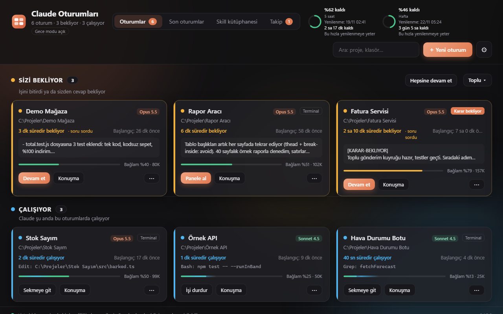
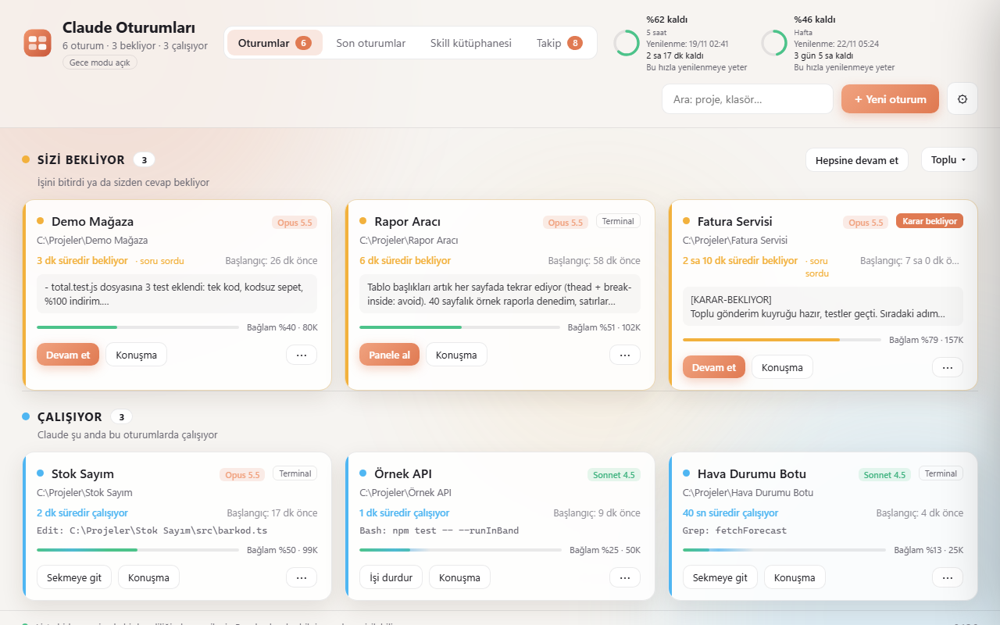
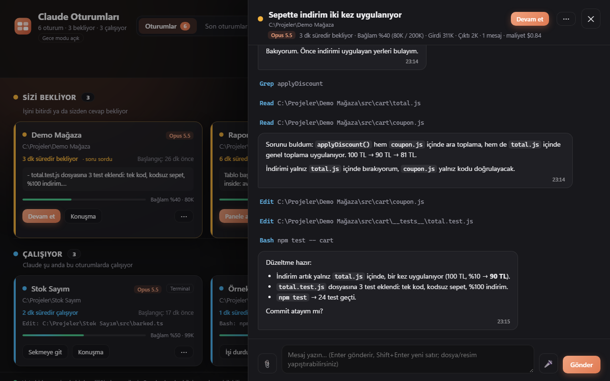
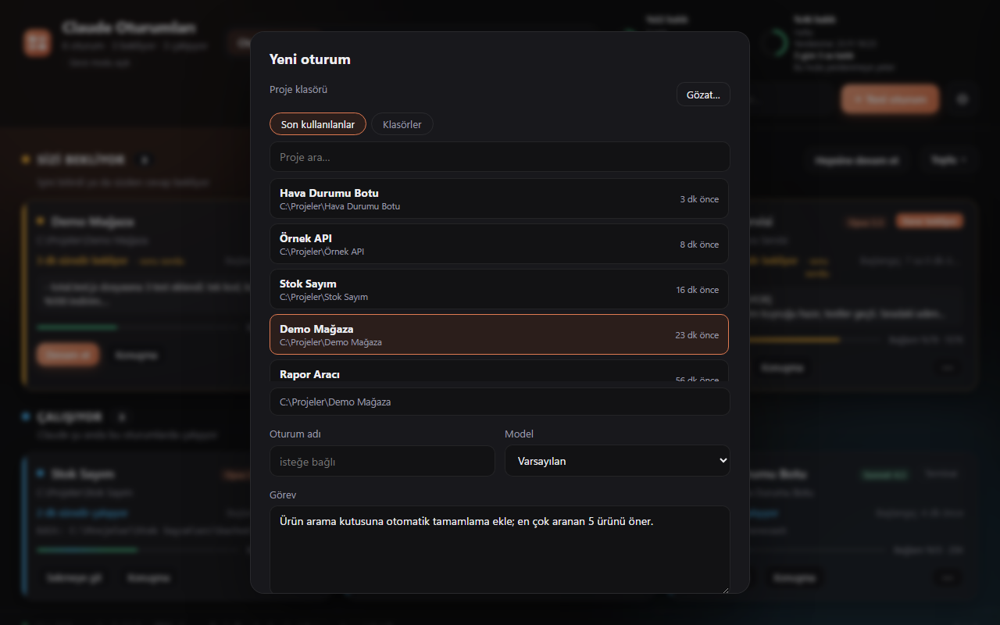
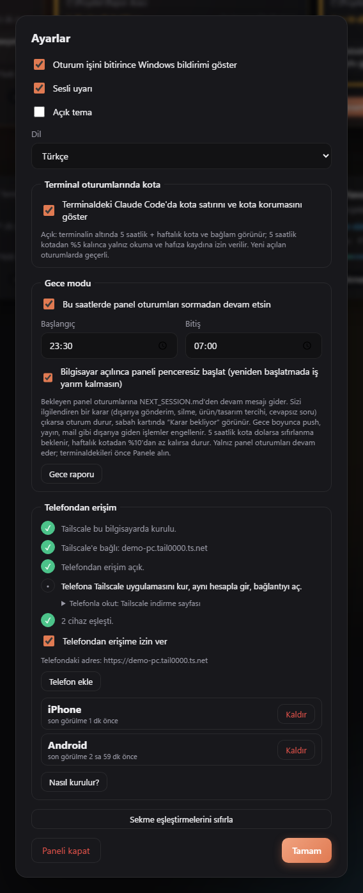
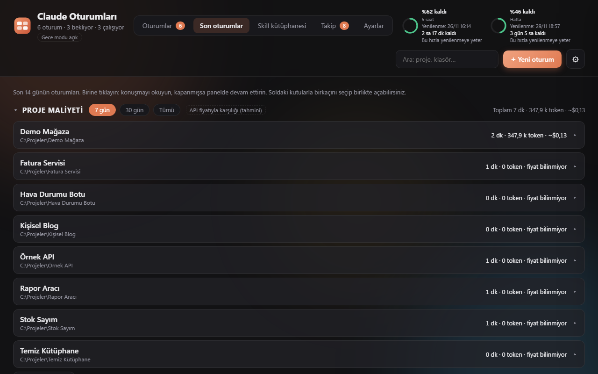
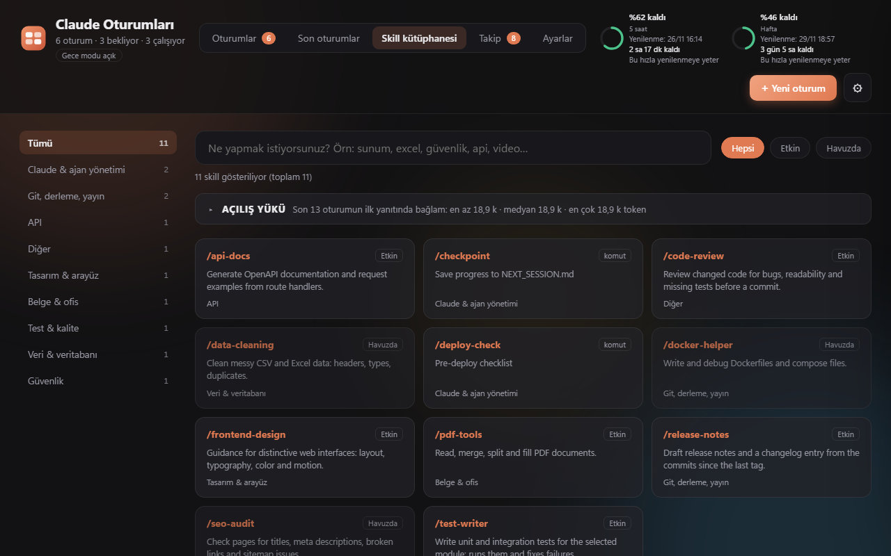
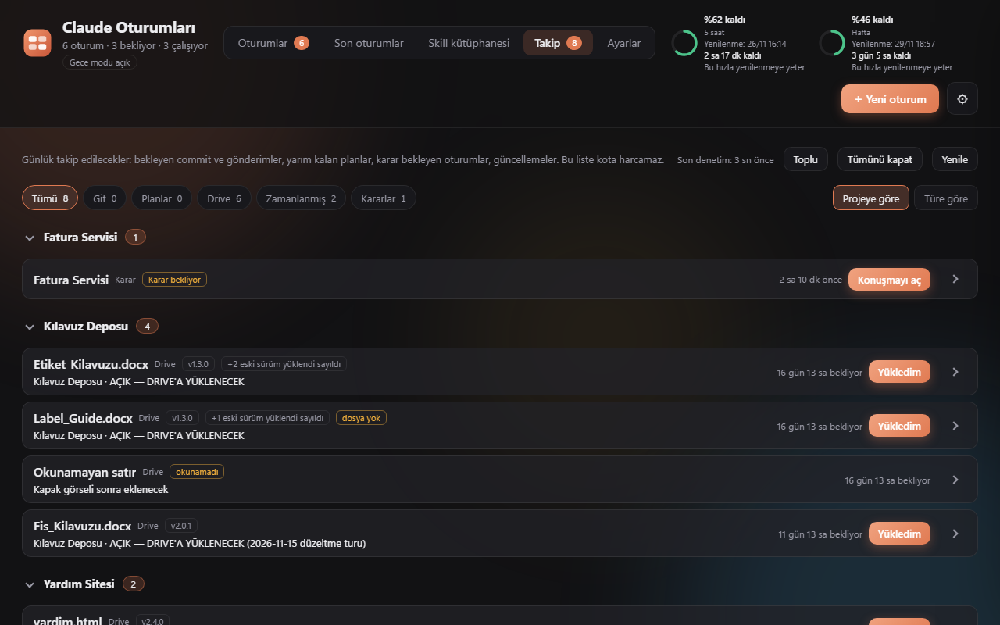
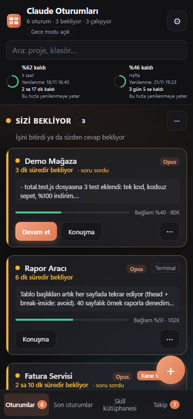
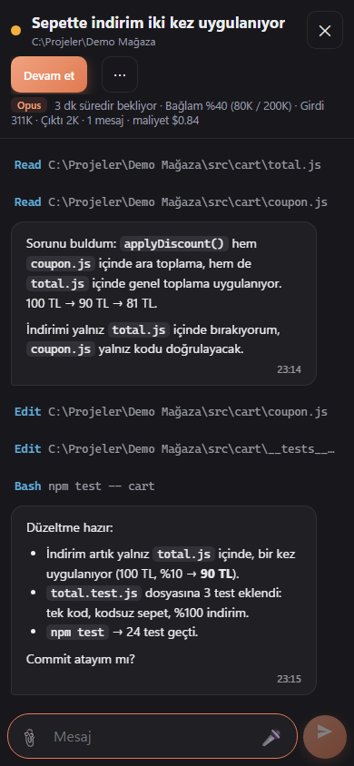

[English](README.md) | **Türkçe**

# Claude Oturum Paneli

Bilgisayarda açık olan tüm Claude Code oturumlarını tek ekranda gösteren küçük bir uygulama. Windows ve macOS'ta çalışır.
Çift tıklayınca adres çubuğu olmayan bir pencere açılır; arkada yalnız bu bilgisayardan erişilen
(`127.0.0.1`) küçük bir web sunucusu çalışır.



> Ekran görüntülerindeki projeler, oturumlar ve yollar uydurmadır (demo verisi).

## Özellikler

### Oturumlar

- Oturumları iki şeritte gösterir: **Sizi bekliyor** (işini bitirdi / cevap bekliyor) ve **Çalışıyor**.
- Kartta klasör, ne kadar süredir beklediği/çalıştığı, ne zaman başladığı.
- **Model ve bağlam**: kartta model rozeti, bağlam doluluğu çubuğu (pencere boyutu oturumun sonuç kaydından / statusline'dan öğrenilir), son mesajın son satırları, çalışanda son araç; konuşma başlığında girdi/çıktı token, mesaj ve sıkıştırma sayısı, maliyet.
- **Pencereye git**: oturumun terminal penceresini öne getirir.
- **Arka plan işi** (0.18.0): panel oturumunda arka planda süren alt ajan ya da komut kartta rozetle ("arka planda: 1 alt ajan, 1 komut"), alt bilgide toplam sayıyla görünür. Alt bilgideki göstergeye basınca liste açılır (0.19.0): hangi oturumda, ne işi, türü, ne zamandır sürdüğü; takılmış olabilecek iş kırmızı.
- **Codex oturumları** (0.18.0, salt okuma): Codex CLI kuruluysa açık ve çalışan Codex oturumları ayrı şeritte, Son oturumlar'da "Codex" rozetiyle; üst çubukta Codex kota göstergesi. Panel Codex'e hiçbir şey yazmaz.
- **İki Claude hesabı** (0.20.0): kişisel ve şirket hesabı aynı bilgisayarda. Ek hesap `~/.claude-<ad>` klasörüdür (`CLAUDE_CONFIG_DIR` ile giriş yapılmış). Üst çubukta her hesabın kotası, kartta oturumun hesabı, ⋯ menüsünde "öteki hesapta devam et" (aynı konuşma o hesapla açılır), yeni oturumda proje başına hesap, bir hesapta kota azalınca boştaki oturumları öteki hesaba geçirme önerisi; gece modu her hesabın kendi kotasına bakar.
- **Sekmeye git**: Windows Terminal'de doğru sekmeyi seçer (sekme adı klasör adıyla eşleşir; eşleşmezse bir kez sorar, seçimi hatırlar).
- Bir oturum işini bitirince Windows bildirimi + ses.
- Arama (`/`), yeni oturum (`N`), açık/koyu tema, Türkçe/İngilizce.



### Konuşma ve panel oturumları

- **Konuşma paneli** (karta tıkla): oturumun mesajları ve araç adımları canlı akar.
- **Panelde oturum**: yeni oturum panelin içinde çalışır (`claude -p --input-format stream-json`); mesaj buradan yazılır, iş durdurulur, oturum kapatılır. Kapalı bir oturuma yazınca `--resume` ile kaldığı yerden sürer.
- **Kaydet ve temizle / Kaydet ve kapat** (panel oturumları): oturum önce durumunu kaydeder (`/smart-clear` varsa o, yoksa CLAUDE_MEMORY.md + NEXT_SESSION.md güncelleme mesajı); temizlede ardından `/clear` + `devam` ile temiz bağlamda sürer, kapatta kapanır. Kartta duruma göre birincil düğme (Devam et / Kaydet ve temizle / Panele al) ve ⋯ menüsü; çalışan oturuma "iş bitince devam et / temizle / kapat". Başlıktaki **Toplu ▾ → Seç…** (ya da Ctrl + tık) ile seçilen oturumlara uygulanır (terminaldeki oturumlar da seçilir; toplu **Panele al** ile panele taşınır); "Hepsini …" seçenekleri de aynı menüde.



### Yeni oturum

- **Yeni oturum**: klasör ve görev yazılır, `claude --bg` ile arka planda başlar.



### Kota

- **Kota**: 5 saatlik ve haftalık kota halkaları, sıfırlanmaya kalan süre, "bu hızla" tahmini. Panel kotayı kendisi okur (Anthropic kullanım API'si; kimlik Windows'ta `~/.claude/.credentials.json`, Mac'te Anahtar Zinciri), statusline betiği gerekmez.
- **Kota koruması**: panelin başlattığı oturumlarda 5 saatlik kotadan %5 kalınca yalnız okuma ve hafıza kaydına (CLAUDE_MEMORY.md / NEXT_SESSION.md) izin verilir, ekstra ücretli kullanıma kayılmaz (`ClaudePanel --quota-guard`, `--settings` ile verilir; kendi `quota-guard` hook'unuz varsa eklenmez).
- **Terminalde kota** (Ayarlar, varsayılan kapalı): terminaldeki Claude Code'un altında plan, kota ve bağlam satırı (`ClaudePanel --statusline`) ve aynı kota koruması. `~/.claude/settings.json`'a yazılır; mevcut durum satırınız yedeklenir, kutu kapatılınca geri gelir. Python gerekmez.

### Gece modu ve yeniden başlatma

- **Gece modu**: belirlenen saatlerde bekleyen panel oturumları NEXT_SESSION.md'den sormadan devam eder. Sizi ilgilendiren bir karar çıkarsa oturum durur, kartında "Karar bekliyor" görünür; panelin kendi hook'u (panelin başlattığı oturumlara `--settings` ile verilir, Mac'te de çalışır) dışarıya giden işlemleri (push, yayın, mail, GitHub'a yazma, curl/wget/PowerShell ile veri gönderme, ssh/scp/rsync) engellemeye çalışır. Bu **en iyi çaba** bir önlemdir: komut metnine bakan bir yasak listesidir, her yolu yakalayamaz (ör. bir betik dosyasının içinden yapılan istek). Asıl koruma Claude Code'un izin ayarlarıdır (`settings.json` → `permissions.deny` / `ask`); dışarıya gitmemesi gereken işlemleri orada da kapatın. Koruma dosyası okunamazsa hook riskli işlemi güvenli tarafta kalarak engeller; kota dolarsa sıfırlanma beklenir. Sabah Ayarlar → Gece raporu.
- **Bilgisayar açılınca başlat** (Windows: Run kaydı, Mac: LaunchAgent): yeniden başlatmadan sonra panel penceresiz açılır, oturumları geri bağlar; yarıda kalan işe devam ettirir. Gece penceresinde bilgisayar boşta uyumaz (Windows `SetThreadExecutionState`, Mac `caffeinate`).
- **Paneli yeniden başlat** (0.18.0, Ayarlar; telefondan da): çalışan oturum yokken panel kendini aynı portta yeniden başlatır; diskte daha yeni sürüm varsa "Yeni sürüm hazır" notu çıkar. Arka planda iş sürüyorsa iş listelenir, "İşler bitince yeniden başlat" seçilebilir.



### Son oturumlar

- **Son oturumlar**: son 14 günün konuşmaları; aç, oku, devam ettir.
- **Proje maliyeti** (0.18.0): proje başına çalışma süresi, token ve API fiyatıyla karşılığı (tahmini; Max planında token başına ödeme yapılmaz), 7 gün / 30 gün / tümü.



### Skill kütüphanesi

- **Skill kütüphanesi**: etkin, havuzdaki ve eklenti skill'leri açıklamalarıyla; ada tıklayınca `/komut` panoya kopyalanır.
- **Açılış yükü** (0.18.0): her oturumun başında, daha bir şey yazılmadan modele giden bağlam (son oturumların en az / medyan / en çok değeri).



### Takip

- **Takip**: günlük takip edilecekler tek sekmede, kota harcamadan. **Git**: Claude'un çalıştığı projelerin depolarında commit'lenmemiş dosya ve gönderilmemiş commit sayısı (`git fetch` yapılmaz; temiz depolar yalnız sayı olarak), depo başına tek düğme: "Commit et", "Gönder" ya da "Commit et ve gönder" (ayrıca "Tümünü commit et ve gönder"). Bunlar oturum kartı açmaz: "Gönder" panelin doğrudan yaptığı `git push`tur, önce gönderilecek commit'ler gizli bilgi için denetlenir (izin dosyası, `.env`, belirteç kalıbı varsa gönderilmez, nedeni satırda yazar, değer gösterilmez); "Commit et" gizli arka plan işi olarak çalışır, yalnız kararınız gerekirse görünür oturuma döner. Açık oturumu olan projeler burada gizlenir. Liste projeye göre gruplanır (ya da türe göre bölümlenir); gruplar açılır-kapanır, süzgeç çipleri ve görünüm hatırlanır. Satırlar "yarına ertelenebilir" ya da durumu değişene kadar gizlenebilir; üstteki "Toplu" menüsüyle birden çok öğe birlikte işlenir. **Sıradaki işler**: proje klasörlerindeki `NEXT_SESSION.md` dosyaları, kısa özet ve yaşıyla (3 günden eskiyse "eski plan"), "Devam et". **Karar bekleyenler**: gece modunda kararda duran oturumlar. **Drive'a yüklenecekler**: proje klasörlerindeki `GUNCELLEME_KUTUGU.md` kütüklerinde açık duran dosyalar (sürüm ve bekleme süresiyle; aynı belgenin birden çok sürümü açıksa yalnız en günceli gösterilir, eskiler yüklendi sayılır); "Yükledim" yerel bir işarettir, "Kütüğü kapat" kütüğü bir arka plan oturumuna güncelletir (panel kütüğe kendisi yazmaz). **GitHub**: kendi depolarınızdaki açık issue ve PR'lar (bilgisayardaki `gh` ile, 15 dakikada bir, yalnız okuma); son söz başkasındaysa "cevap bekliyor" diye öne çıkar ve bir kez bildirim verir. "GitHub'da aç" ve depo bilinen bir klasördeyse "Oturumda ele al" (istem GitHub'a yazmayı yasaklar). **Zamanlanmış işler**: bilgisayarın zamanlayıcısında (Windows Görev Zamanlayıcı, macOS LaunchAgents) projelerinizle ilgili görevler (sonraki / son çalışma, son sonuç; "Klasörde göster" ve onaylı "Devre dışı bırak" yalnız bilgisayardan), Claude görev dosyaları (yalnız varlık ve tarih), açık oturumlardaki tekrarlı işler (`/loop`, zamanlanmış görev: süre, harcanan token, üst üste boş dönen tur ve düşük kota uyarısı; onaylı "Durdur" panel oturumuna mesaj gönderir), bulut rutinleri bağlantısı ve verilmiş sözler (`NEXT_SESSION.md`'deki `TAKİP: YYYY-AA-GG — metin` satırları; tarihi geçen kırmızı ve önde). Panel kendiliğinden hiçbir şeyi durdurmaz. **Planlı işler** (aynı bölümde, "Planla"): seçilen saatte (bir kez, her gün, hafta içi) bir projede görünür oturum açar, işi ayrı bir çalışma kopyasında (`panel/` dalı, push yok) yapıp kontrolüne bırakır ("İncele", "Birleştir", "At") ya da 5 saatlik kota penceresini Haiku ile çok kısa bir istekle erken başlatır. Projede açık oturum varsa ya da kota düşükse 3 saat yeniden denenir; panel kapalıyken iş çalışmaz, işe 12 saat kala bilgisayar uyanık tutulur. **Güncellemeler**: panelin yeni sürümü sürüm sayfası bağlantısıyla gösterilir (panel kendini güncellemez). Claude Code'un yeni sürümü çıkınca panel `claude update`'i arka planda kendisi çalıştırır (her sürüm için bir kez; başarısız deneme 6 saat sonra yinelenir); satırda "Güncelleniyor…", sonra "kuruldu, yeni oturumlarda geçerli" ya da hata yazar; "Şimdi güncelle" hemen çalıştırır. Açık oturumlar başladıkları sürümle sürer. Sekme başlığında bekleyen madde sayısı.
- **Mail ve takvim** (0.18.0, Gmail / Google Workspace): Ayarlar'da adım adım kurulum (e-posta, uygulama şifresi, Bağlan ve dene, isteğe bağlı Google Takvim iCal adresi). Önemli mailler ve önümüzdeki 24 saatin etkinlikleri Takip'te; mail salt okunur (IMAP, okundu yapılmaz). Hesap başına "Benim adreslerim / gruplarım": grup ya da liste adresine gelen mailler de size gelmiş sayılır, sık geçen adresler öneri olarak çıkar. Şifre ve iCal adresi şifreli saklanır.
- **Gizli bilgi engelinde çıkış yolu** (0.18.0, Takip → Git): gönderim denetime takılınca bulgular dosya:satır ile listelenir (değer maskeli); "Claude'a incelet" ya da (yalnız anahtar/parola kalıbında) onaylı "Test verisi, yine de gönder".
- **Proje başına tek oturum**: içinde zaten oturum olan projede (git kökü; alt klasörler dahil) yeni oturum sessizce açılmaz. Panel sorar: mevcut oturuma gönder, iş bitince gönder, ayrı çalışma kopyasında aç (`git worktree`, kardeş klasör) ya da yine de aç. Oturum kartında "Bu projede N oturum açık" yazar; aynı projede daha önce başlamış bir oturum çalışırken sonrakinin dosya yazması ve `git commit/push` komutları bir hook ile bekletilir.



### Telefondan erişim

- **Telefondan erişim** (isteğe bağlı, varsayılan kapalı): iPhone/Android'den panel, Tailscale'in şifreli özel ağı üzerinden; internete port açılmaz, her telefon kare kodla eşleştirilir. Kurulum panelde Ayarlar → Telefondan erişim → **Nasıl kurulur?**
- **Telefondan bilgisayarın masaüstüne bağlanma** (panelin parçası değil, aynı Tailscale bağlantısıyla): Windows'ta Uzak Masaüstü + Windows App, Mac'te Ekran Paylaşma + VNC uygulaması. Görselli adımlar: [docs/uzak-masaustu.md](docs/uzak-masaustu.md).

<p>
  
  
</p>

## Kurulum

İndirme: [son sürüm](https://github.com/ahmetunaluzun/claude-oturum-paneli/releases/latest). Claude Code kurulu ve giriş yapılmış olmalı; panel ayrıca hesap istemez.
İndirilen dosyayı doğrulamak için: `SHA256SUMS` (Windows: `Get-FileHash <zip>`, Mac: `shasum -a 256 <zip>`).

### Windows

`ClaudePanel-<sürüm>-win-x64.zip`'i aç, `ClaudePanel.exe`'yi çalıştır. Gereken: Windows 10/11, [.NET 10 çalışma zamanı](https://dotnet.microsoft.com/download/dotnet/10.0) (ASP.NET Core Runtime), Edge veya Chrome (pencere için).

### macOS

1. Terminal'de `uname -m` yaz: `arm64` ise `ClaudePanel-<sürüm>-osx-arm64.zip` (Apple Silicon), `x86_64` ise `osx-x64` (Intel).
2. Zip'i indir, çift tıklayıp aç.
3. İlk açılış (Windows'ta üretilen dosya imzasız gelir):

```
cd <klasör>
xattr -dr com.apple.quarantine . 2>/dev/null; chmod +x ClaudePanel
codesign --force --sign - ClaudePanel      # Apple Silicon'da zorunlu (yerel imza)
codesign --force --sign - runtimes/*/*.dylib   # sesle yazma kitaplıkları
./ClaudePanel
```

Gereken: Chrome, Edge, Brave ya da Chromium (yoksa varsayılan tarayıcıda açılır), `claude` kurulu
(`~/.local/bin/claude`, Homebrew ya da PATH). Mac'te farklar:
- **Sekmeye git** iTerm2 ve Terminal'de çalışır; sekme claude sürecinin tty'siyle kesin eşlenir. İlk kullanımda
  macOS "Otomasyon" izni sorar (Sistem Ayarları → Gizlilik ve Güvenlik → Otomasyon).
- Menü çubuğu ikonu yok; oturum bitince macOS bildirimi gelir. Kapatmak: Ayarlar → Paneli kapat.
- Sesle yazma Apple Silicon'da Metal ile, Intel Mac'te işlemciyle çalışır (Whisper.net paketinin macOS kitaplıkları); hızı Mac'te ölçülmedi.
- Gece penceresinde `caffeinate` boşta uykuyu engeller; kapak kapatılınca Mac yine uyur.
- Klasör seçme, pano (Finder'da ⌘C ile kopyalanan dosya, ekran görüntüsü) AppleScript ile.
- Mac sürümü Windows'ta derlendi; gerçek Mac'te henüz denenmedi.

### Kullanım notları

Port varsayılan `8790`; değiştirmek için `CLAUDE_PANEL_PORT` ortam değişkeni.
Panel açıkken exe'ye yeniden tıklamak yalnız pencereyi açar.
Kapatmak: Ayarlar → Paneli kapat.

## Güncelleme

- **Bilgisayar (Windows):** yeni `ClaudePanel.exe` aynı yere konur; açık panel eskiyse yeni exe açılınca "Yeni sürüm hazır" diye sorar, onaylanınca eskisini kapatıp kendisi açılır. Paneldeki oturumlar kaldığı yerden geri gelir.
- **Mac:** yeni paket indirilip eski klasörün yerine açılır, ilk açılış adımları (`xattr`, `codesign`) her yeni pakette tekrarlanır.
- **Telefon:** ayrı bir güncelleme yok. Telefondaki panel (tarayıcı sekmesi de, ana ekrana yüklenen uygulama da) bilgisayardaki panelin sayfasıdır; sayfa önbelleğe alınmaz, her açılışta bilgisayardan gelir. Bilgisayar yeni sürüme geçince telefonda sayfayı yenilemek ya da uygulamayı kapatıp açmak yeter; uygulamayı silip yeniden yüklemek gerekmez.
- **0.9.1 öncesinde eşleşmiş telefonlar (bir kez):** eski cihaz çerezi ana ekrandaki uygulamadan açılışta gönderilmiyordu. Bilgisayar 0.9.1+ olunca telefonda paneli bir kez **tarayıcı sekmesinde** açın (çerez yenilenir), sonra uygulamadan açın. Yine kod isterse uygulamanın içinde bir kez eşleştirin.

## Nasıl çalışır

Claude Code her oturum için `~/.claude/sessions/<pid>.json` dosyası tutar (durum: `busy`, `idle`, `shell`).
Panel bu dosyaları 2,5 saniyede bir okur, süreç hâlâ aynı mı diye başlangıç zamanıyla doğrular.
Claude'a dokunmaz, ayar değiştirmez.

## Güvenlik

- Sunucu yalnız `127.0.0.1`'e bağlanır; `Host` başlığı başka bir ad ise istek reddedilir.
- Değişiklik yapan her istek, her açılışta üretilen rastgele anahtarı ve aynı kökeni ister.
- Yeni oturum komutu kabuktan geçmez (`ArgumentList`); klasör var olmalı.
- Dış sunucudan yazı tipi, kütüphane veya analitik yüklenmez.
- **Güncelleme denetimi (0.11.0):** panel en çok 6 saatte bir `api.github.com` (panelin son sürümü) ve `registry.npmjs.org` (Claude Code'un son sürümü) adreslerine kimliksiz birer istek yapar; yanıt panel veri klasöründe saklanır. Başka dış istek: kota okuma (Anthropic kullanım API'si) ve Takip'te GitHub açıksa bilgisayardaki `gh` ile 15 dakikada bir yalnız okuma (0.17.0; Ayarlar'dan kapatılır).
- **Telefondan erişim (0.7.0, varsayılan kapalı):** açılınca yalnız bu makinenin Tailscale adı (`*.ts.net`) ek olarak kabul edilir. O addan gelen her istek eşleştirilmiş cihaz çerezi ister; eşleştirme bilgisayardaki panelden başlatılır (tek kullanımlık kod, 5 dk, 5 yanlış deneme). Bilgisayarın ekranında/panosunda iş yapan uçlar telefondan kapalıdır. Test: `bash tools/remote_guvenlik_testi.sh` (8791'de `CLAUDE_PANEL_REMOTE_HOST=test.ts.net` ile açılmış test kopyasına karşı).

## Derleme

Proje iki hedefle derlenir: `net10.0-windows` (Windows) ve `net10.0` (macOS). Platforma özel kod
`src/ClaudePanel/Platform/Windows` ve `Platform/Mac` altında; sınıf adları aynı, hedefe göre biri derlenir.

**Windows**

```
dotnet publish src/ClaudePanel -c Release -f net10.0-windows -o dist
dist\ClaudePanel.exe
```

Gereken: Windows 10/11, .NET 10 çalışma zamanı, Edge veya Chrome (pencere için).

**macOS** (Windows'ta da üretilebilir; çalışma zamanı içinde gelir)

```
dotnet publish src/ClaudePanel -c Release -f net10.0 -r osx-arm64 --self-contained true -o dist-mac/osx-arm64
```

Intel Mac için `osx-x64`. Ardından `runtimes/` altında yalnız `macos-arm64` (ya da `macos-x64`) bırakılır, `.pdb` silinir ve `python tools/mac_zip.py <sürüm>` ile zip'lenir (yollar `/` ile, `ClaudePanel` 0755). Mac'te ilk açılış adımları yukarıda, [macOS](#macos) bölümünde.

**Görselleri yeniden üretmek:** `pwsh -File tools\readme_gorsel_uret.ps1` (uydurma `.claude` klasörü ve test kopyasıyla `docs/img/*.png`; gerçek oturum ve ayarlara dokunmaz).

## Bilinen sınırlar

- Windows'ta sekme, Windows Terminal'deki sekme adıyla bulunur; iki sekme aynı adı taşırsa ilki seçilir.
- Panel kapanırken çalışan iş yarıda kalır; oturumlar panel yeniden açılınca geri bağlanır (0.4.0), o an çalışıyor olanlara devam mesajı gider (0.6.0).
- Gece modu yalnız panel oturumlarını sürdürür; terminaldeki oturumlar önce Panele alınmalı. Windows güncelleme sonrası yeniden başlarsa panelin açılması için Windows'ta oturum açılmalı (Ayarlar → Hesaplar → Oturum açma seçenekleri → "Güncellemeden sonra kurulumu bitirmek için oturum açma bilgilerimi kullan").
- `idle` durumu "işini bitirdi" ile "izin bekliyor"u ayırmaz.
- `sessions/*.json` biçimi Claude Code'un iç dosyasıdır; sürüm değişince uyarlama gerekebilir.

## Lisans

MIT — bkz. [LICENSE](LICENSE). Bağımsız bir projedir; Anthropic tarafından yapılmamış ya da onaylanmamıştır.

## Sürüm geçmişi

| Sürüm | Tarih | Değişen alan | Eski değer | Yeni değer | Neden |
|---|---|---|---|---|---|
| 0.20.0 | 2026-11-24 | Oturumlar: Claude hesabı | Panel yalnız tek Claude hesabını görüyordu | İki hesap: hesap başına kota, kartta hesap, öteki hesapta devam et, proje başına hesap, kota azalınca geçiş önerisi, gece modu hesap başına kota | Kişisel ve şirket hesabını birlikte kullanma ihtiyacı |
| 0.19.0 | 2026-11-23 | Konuşmadaki klasör yolu; alt bilgideki arka plan göstergesi; Sekmeye git / VS Code'a git | Sonu \ olan yol Belgeler'i açıyordu; gösterge yalnız sayı veriyordu; Windows öne getirmeyi reddedince panel yine "oldu" diyordu, alt klasördeki oturumda yanlış VS Code penceresi geliyordu | Yol doğru klasörü açar; göstergeye basınca oturum, iş, tür ve süre listesi; öne gelme ölçülür, olmazsa uyarı; başlık eşleşmesinde üst klasörler de denenir | Kullanıcı bildirimi ve GitHub issue #1 (madde 4) |
| 0.18.0 | 2026-11-23 | Takip: mail ve takvim; oturumlar: Codex, arka plan işi; panel: yeniden başlat; Git: gizli bilgi engeli; proje maliyeti, açılış yükü | Mail/takvim yoktu; Codex oturumları görünmüyordu; panel yeniden başlatılamıyordu, arka plandaki iş görünmüyordu; gizli bilgi engelinde satırdan bir şey yapılamıyordu; proje başına maliyet ve oturum açılış yükü görünmüyordu | Gmail/Workspace IMAP + uygulama şifresi ve iCal ile mail ve takvim (grup adresleri dahil); Codex şeridi ve kotası (salt okuma); Paneli yeniden başlat ve "işler bitince yeniden başlat"; arka plan işi rozeti; bulgu listesi, Claude'a incelet, onaylı "yine de gönder"; proje maliyeti; açılış yükü | GitHub issue #1 (Codex) ve günlük kullanımda çıkan ihtiyaçlar |
| 0.17.0 | 2026-11-22 | Takip: GitHub, zamanlanmış işler; güvenlik; oturum kartı | GitHub issue/PR'ları panelde yoktu; görev hata kodu açıklamasızdı, görevden müdahale yoktu; gece koruması bazı yazma komutlarını kaçırıyor, koruma dosyası okunamazsa serbest bırakıyordu; soru bekleyen oturum "Çalışıyor"da görünüyordu | Takip'te GitHub bölümü (cevap bekleyenler öne çıkar); görevde kod açıklaması, "bu görev için normal", Şimdi çalıştır / Logu aç / Claude'a incelet; gece koruması genişledi, okunamazsa engeller; görev metninden önce `--`; dikte modeli SHA256; soru bekleyen oturum bekleyenlerde; kartta oturumun yeri (masaüstü uygulaması / VS Code / terminal) ve sanal masaüstü no | GitHub issue #1 ve günlük kullanımda kaçan işler |
| 0.16.0 | 2026-11-19 | Takip: planlı işler | Panel belirli saatte iş başlatamıyordu | Zamanlanmış işler bölümünde "Planla": seçilen saatte (bir kez, her gün, hafta içi) oturum açar, işi ayrı çalışma kopyasında yapıp kontrolüne bırakır (İncele / Birleştir / At) ya da 5 saatlik kota penceresini erken başlatır; açık oturum ya da düşük kotada 3 saat yeniden dener | İşleri bilgisayar başında olmadan, kontrol elde kalarak çalıştırmak |
| 0.15.1 | 2026-11-19 | Takip: Drive'a yüklenecekler | Bir belgenin açık duran her sürümü ayrı satırdı (aynı kılavuzun 1.2.0, 1.2.1, 1.3.0'ı gibi) | Yalnız en güncel sürüm listelenir; eskiler yüklendi sayılır ("+N eski sürüm" etiketi), "Kütüğü kapat" onları da kapatır | Yalnız gerçekten yüklenecek sürümün görünmesi |
| 0.15.0 | 2026-11-19 | Takip: Claude Code güncellemesi | Yeni Claude Code sürümü yalnız bildiriliyordu ("claude update ile güncellenir") | Yeni sürüm çıkınca panel `claude update`'i kendisi çalıştırır (sürüm başına bir kez, başarısızsa 6 saat sonra yeniden), ilerlemeyi ve sonucu gösterir; "Şimdi güncelle" düğmesi | Claude Code'un elle uğraşmadan güncel kalması |
| 0.14.0 | 2026-11-19 | Takip: zamanlanmış işler | Zamanlayıcı görevleri, açık oturumlardaki tekrarlı işler (`/loop`, cron) ve verilen sözler panelde görünmüyordu | "Zamanlanmış işler" bölümü: Görev Zamanlayıcı / LaunchAgent görevleri (proje, sonraki / son çalışma, sonuç; Klasörde göster, onaylı Devre dışı bırak, yalnız bilgisayardan), Claude görev dosyaları (yalnız varlık + tarih), açık oturumlardaki tekrarlı işler (süre, token, boş tur ve kota uyarısı, onaylı Durdur), bulut rutinleri bağlantısı | Arka planda çalışan ve kota harcayan işlerin tek yerde görülmesi; panel kendiliğinden hiçbir şeyi durdurmaz |
| 0.14.0 | 2026-11-19 | Takip: verilmiş sözler | "Yarın bakarım" gibi sözler oturum kapanınca unutuluyordu | `NEXT_SESSION.md`'deki `TAKİP: YYYY-AA-GG — metin` satırları Takip'te; tarihi geçen kırmızı ve önde. "Kaydet ve kapat" ve gece modu istemleri sözü bu biçimde yazdırır | Verilen sözün tarihi gelince hatırlanması |
| 0.13.0 | 2026-11-19 | Takip: Drive'a yüklenecekler | Güncelleme kütüklerinde (`GUNCELLEME_KUTUGU.md`) açık duran Drive maddeleri panelde görünmüyordu | Kütüklerdeki "Drive'a yüklenecek" dosyalar listelenir: proje, dosya, sürüm, bekleme süresi; "Yükledim" (yerel işaret, dosya değişirse geri gelir), "Klasörde göster", "Kütüğü kapat" (kütüğü arka plan oturumu günceller) | Yüklenmeyi bekleyen dosyaların unutulmaması |
| 0.13.0 | 2026-11-19 | Takip: liste | Yalnız türe göre bölümler; öğe ertelenemez, gizlenemezdi | Projeye göre gruplama (varsayılan) ya da türe göre; süzgeç çipleri (sayılı); satırda "Ertele (yarına)" ve "Gizle"; yeni çıkan öğede "yeni" işareti; sıkı satır, tıklayınca ayrıntı | Uzun listede önemli olanı öne almak, kaydırmayı azaltmak |
| 0.13.0 | 2026-11-19 | Takip: toplu işlemler | "Tümünü commit et ve gönder" yalnız Git bölümü açıkken görünüyordu | Üstte "Toplu" menüsü: tüm bekleyen depoları commit et ve gönder; öğe seçerek Commit et ve gönder, Ertele, Gizle, Yükledim | Toplu işlemlerin bölüm kapalıyken de bulunabilmesi |
| 0.12.1 | 2026-11-18 | Oturum kartı: "Bu projede N oturum açık" | Yalnız bilgi yazısı | Dokununca projedeki oturumlar için "Kaydet ve kapat", "Panele al", "Konuşmayı aç" | Çakışmayı kartın üstünden çözebilmek |
| 0.12.1 | 2026-11-18 | Çakışma penceresi (terminal oturumu) | Terminal oturumunu Oturumlar sekmesinden panele alın diye hatırlatma | İlk seçenek "Panele al ve gönder": terminal oturumu panele alınır, istek ona yazılır | İkinci oturum açmadan aynı konuşmada devam etmek |
| 0.12.0 | 2026-11-18 | Takip: commit / gönder | Ayrı "Commit et" ve "Gönder" düğmeleri, her biri görünür panel oturumu açıyordu (ikisine basınca aynı depoda iki oturum) | Depo başına tek düğme ("Commit et" / "Gönder" / "Commit et ve gönder") ve "Tümünü commit et ve gönder"; oturum kartı yok: gönderimi panel gizli bilgi denetiminden sonra kendisi yapar, commit gizli arka plan işi | Aynı depoda iki oturum açılıyordu; commit/gönder oturum listesini kalabalıklaştırmamalı |
| 0.12.0 | 2026-11-18 | Aynı projede birden çok oturum | Aynı klasöre farklı istek her zaman yeni oturum açıyordu | Panel sorar (mevcut oturuma gönder / iş bitince gönder / ayrı çalışma kopyası / yine de aç); kartta rozet; önce başlayan oturum çalışırken sonrakinin yazması hook ile bekletilir | Aynı dosyalara yazan iki oturum birbirinin işini bozuyor |
| 0.12.0 | 2026-11-18 | Takip: görünüm | Bölümler hep açık; oturumu açık projeler de listede | Açılır-kapanır bölümler (durum hatırlanır), "Tümünü aç/kapat"; oturumda açık projeler tek satırlık notla gizlenir | Kaydırmayı azaltmak; o projeyle açık oturum zaten ilgileniyor |
| 0.11.1 | 2026-11-18 | Lisans | Lisans dosyası yoktu | MIT lisansı (LICENSE) ve bu bölüm | Depo herkese açık; kullanım koşulları yazılı olmalı |
| 0.11.1 | 2026-11-18 | Onay pencereleri | Tarayıcının yerleşik onay kutusu (Mac uygulama penceresinde görünmüyordu) | Panelin kendi penceresi: başlık, eylemi söyleyen düğme, tehlikeli işlemde kırmızı | Onaylar Mac'te görünmüyordu |
| 0.11.1 | 2026-11-18 | Sürüm geçmişi | 0.8.12 satırında proje adları | Genel ifade | Kişisel proje adları herkese açık metinden çıkarıldı |
| 0.11.0 | 2026-11-18 | README | Tek dil (Türkçe), ekran görüntüsü yok | README.md İngilizce, README.tr.md Türkçe; uydurma veriyle ekran görüntüleri; kurulum bölümü | Kullanıcı isteği: depo herkese açık, iki dilli ve görselli tanıtım |
| 0.11.0 | 2026-11-18 | Takip sekmesi | Bekleyen commit/gönderim, yarım planlar ve güncellemeler tek yerde görünmüyordu | Takip sekmesi: Git, Sıradaki işler, Karar bekleyenler, Güncellemeler; satırdan panel oturumu başlatma | Kullanıcı isteği: günlük takip edilecekler için ayrı sekme |
| 0.11.0 | 2026-11-18 | Oturum başlatma | Yanıt gecikince Başlat'a art arda basılırsa aynı oturum birkaç kez açılıyordu | İstek sürerken düğme kilitli; sunucu aynı isteği 20 sn içinde ikinci kez başlatmaz; başlatma süresi loga yazılır | Canlıda aynı oturum 5 kez açıldı |
| 0.11.0 | 2026-11-18 | Güvenlik | Dış istek yalnız kota okuma | + güncelleme denetimi (GitHub, npm; 6 saatte bir, kimliksiz) | Güncellemeler bölümü |
| 0.10.1 | 2026-11-18 | Exe ikonu | Windows varsayılan ikonu | Uygulama simgesi | Görünüm |
| 0.10.0 | 2026-11-18 | Kota | Kota önbelleğini yalnız kullanıcının statusline betiği yazıyordu | Panel kotayı kendisi okur; kota koruması; terminalde kota satırı (Ayarlar) | Başka bilgisayarda kota halkaları boş kalıyordu |
| 0.9.2 | 2026-11-18 | Ayarlar → Telefondan erişim (bilgisayar) | Güncelleme sırasında kitaplık yüklenemeyince kalıcı 500, bölüm boş | Kitaplıklar açılışta yüklenir; kare kod hatası kalıcı olmaz | Eşleşmiş telefon panelde görünmüyordu |
| 0.9.2 | 2026-11-18 | Bildirime / tepsiye tıklama | Her seferinde yeni panel penceresi | Açık pencere öne gelir | Kullanıcı isteği |
| 0.9.2 | 2026-11-18 | Sürüm karşılaştırması | Aynı sürüme "Yeni sürüm hazır" soruluyordu | 3 parçalı karşılaştırma | Hata |
| 0.9.1 | 2026-11-18 | Cihaz çerezi | `SameSite=Strict` | `SameSite=Lax` (sayfa açılışında yenilenir) | Ana ekrandaki uygulamadan açılışta çerez gitmiyor, eşleştirme isteniyordu |
| 0.9.1 | 2026-11-18 | Telefonda Ayarlar → Telefondan erişim | Yalnız "Bu cihaz eşleşmiş" yazısı | Durum, adres, eşleşmiş cihazlar (salt okunur, bu cihaz işaretli) | Kullanıcı isteği: telefonda da aktif olanları görmek |
| 0.9.0 | 2026-11-18 | Mac açılışta başlatma | Mac'te yok (kutu gizli) | LaunchAgent plist (`--no-window`, PATH'li) | Kullanıcı isteği: Mac için gereken işler |
| 0.9.0 | 2026-11-18 | Gece modunda uyku | Engellenmiyordu (Windows + Mac) | Gece penceresinde boşta uyku engellenir | Bilgisayar uyursa gece işi duruyordu |
| 0.9.0 | 2026-11-18 | Gece koruması | `~/.claude/hooks/gece-modu-koruma.py` (yalnız bu bilgisayarda) | Panelin içinde, oturumlara `--settings` ile verilir | Mac'te betik yoktu, koruma çalışmazdı |
| 0.8.13 | 2026-11-18 | Yazma alanı | Yalnız klavye | 🎤 ile sesle yazma; ses bu bilgisayarda Whisper ile yazıya çevrilir | Kullanıcı isteği: dikte, her cihazda aynı ve kesin çözüm |
| 0.8.13 | 2026-11-18 | Kota kutusu | Kalan yüzde ve yenilenme | + bu hızla bitiş zamanı | Kullanıcı isteği: ortalama kullanımla ne zaman biter |
| 0.8.12 | 2026-11-18 | Yeni oturum klasör seçimi | Aramaya yazıp seçmeden başlatınca önceki klasörde açılıyordu; klasörün içine girmek seçmiyordu | Seçilmemiş aramada başlatma durur ve uyarır; içine girilen klasör seçilir | Kullanıcı bir proje için açtığı oturumu başka bir projede buldu |
| 0.8.11 | 2026-11-18 | Konuşmadaki yollar | Düz metin | Var olan yol bağlantı olur; klasör Gezgin'de açılır, dosya seçili gösterilir | Kullanıcı isteği: proje klasörüne tıklayıp gitmek |
| 0.8.10 | 2026-11-18 | Konuşma mesajları | Saat yok | Mesaj altında saat (bugün değilse gün.ay) | Kullanıcı isteği |
| 0.8.10 | 2026-11-18 | 📎 düğmesi (masaüstü) | Panodaki yolu yapıştırıyordu; telefonda yalnız resim | Dosya seçici, her tür, çoklu, 20 MB; özgün adla `pastes`'e kopyalanır | Kullanıcı isteği: gerçek ekleme |
| 0.8.9 | 2026-11-18 | Okunamayan `remote.json` | Boş kayıtla açılıp ilk yazımda eşleşmiş cihazları siliyordu | Kilitliyse 3 sn yeniden dener; bozuksa kopyasını alır; kopya alınamazsa o açılışta dosyaya yazmaz | Telefonun yeniden eşleşme istemesinin olası nedenlerinden biri |
| 0.8.8 | 2026-11-18 | Telefonda uygulama olarak yükleme | Yalnız tarayıcı menüsünden bulunabiliyordu | Ayarlar → Telefondan erişim'de "Uygulama olarak yükle" düğmesi; yükleme penceresi ya da menü yolu | Kullanıcı: "web app gibi indirme" |
| 0.8.7 | 2026-11-18 | Telefonda yazma alanı | Dikdörtgen kutu, yanında "Gönder" yazılı düğme, Enter gönderiyordu | Hap biçimli kutu, içinde 📎, ayrı yuvarlak gönder düğmesi, 1→5 satır büyüme, Enter yeni satır | Kullanıcı: mesaj alanı telefonda WhatsApp gibi olsun |
| 0.8.6 | 2026-11-17 | Telefondan erişim logu | Panelin dosya logu yoktu | Eşleşme, cihaz silme (nedeniyle), reddedilen istek (çerez yok / tanınmayan çerez) `logs\remote-YYYYMMDD.log`'a yazılır | Telefon yenileyince yeniden eşleşme istedi, neden bilinmiyordu |
| 0.8.5 | 2026-11-17 | Telefonda + düğmesi | Yüzen + düğmesi kartların ve alt bilginin üstünde kalıyordu | Aşağı kaydırırken çekilir, yukarı kaydırınca/en üstte/en sonda görünür; alt bilgiye sağ boşluk | Kullanıcı: "Ana ekranda bu + da üstünde kalıyor alanların" |
| 0.8.4 | 2026-11-17 | Kalan süre + arama | Kota kutusunda yenilenmeye kalan süre yoktu; aramada "ic" "Ic-Isler"i bulmuyordu; alt klasörlerde arama yoktu | Kota kutusunda canlı kalan süre; harf/Türkçe karakter farkı gözetmeyen ortak arama; Klasörler aramasında 4 düzeye kadar alt klasör | Kullanıcı: "yenilemeye kalan saati doğru göstermek lazım", "arama alt klasörlerde de çıksa" |
| 0.8.3 | 2026-11-17 | Masaüstüne bağlanma rehberi | Telefondan bilgisayarın masaüstüne nasıl bağlanılacağı yazılı değildi | Panel rehberinde Windows (Uzak Masaüstü + Windows App) ve Mac (Ekran Paylaşma + VNC) bölümü; görselli docs/uzak-masaustu.md; MAC_TEST maddeleri | Kullanıcı: "nasıl yapılır ekleyelim mutlaka", "ss'li olursa daha iyi olur" |
| 0.8.2 | 2026-11-17 | Ayarlar düzeni; seçim tüm oturumlarda | Ayarlar penceresinde onay kutulu satırlar sıkışıp üst üste biniyordu; seçim yalnız panel oturumlarında çıkıyordu | Kart kutusu ayrı sınıf (.sel-box); terminal oturumları da seçilir, toplu çubukta Panele al, uygulanmayan oturumlar atlanıp bildirilir | Kullanıcı: "birbirine girmiş bu alan", "seçim olayı sadece ilk pencerede çıkıyor tüm pencerelerde olması lazım" |
| 0.8.1 | 2026-11-17 | Arama uyarısı; seçim | Arama kutusunda kalan yazı listeyi sessizce süzüyordu; seçimi kaldırma yoktu, tek tek seçim yalnız Ctrl+tık | Gizlenen oturum sayısı + Aramayı temizle, Esc; üzerine gelince onay kutusu, telefonda uzun basma, Seçimi kaldır / Seçimden çık | Kullanıcı: "arama alanında kalan yazıdan kaynaklı", "tümü seç var ama seçimi kaldır yok, tek tek seçmek için nasıl bir yöntem" |
| 0.8.0 | 2026-11-17 | Kart eylemleri; seçerek toplu işlem; model ve bağlam bilgisi | Kartta yalnız Konuşma/Klasör; toplu işlem yalnız "hepsi"; model yalnız konuşma başlığında düz metin; karttaki sarı çubuk bilgi taşımıyordu | Duruma göre birincil düğme + ⋯ menüsü (kart ve konuşma ekranı aynı), iş bitince devam/temizle/kapat, seçip toplu uygula, model rozeti, bağlam çubuğu, son mesaj/son araç, token ayrıntısı | Kullanıcı: "bu ekranda da kaydet devam et temizle mantığını oturtmak lazım", "kullanılan model proje kutusunda", "token kullanımı, context durumu", "seçtiğim oturumlar içinde kaydet kapat" |
| 0.7.1 | 2026-11-17 | Telefon düzeni; kurulum sihirbazı ve rehberi | Telefonda sayfa yana kayıyordu, başlık ekranın yarısını kaplıyordu; kurulum elle anlatılıyordu | Altta sabit sekme çubuğu, yüzen + düğmesi, sıkı başlık; Ayarlar'da adım adım kurulum + "Nasıl kurulur?" rehberi | Kullanıcı: telefon videosu; "kurulum adımları dokümanı panelde"; "isteyen aktif edip kurabilsin" |
| 0.7.0 | 2026-11-17 | Telefondan erişim | Panel yalnız bu bilgisayardan açılabiliyordu | Tailscale ile telefondan (iPhone/Android) erişim; kare kod/kodla cihaz eşleştirme; telefon görünümü | Kullanıcı: telefondan oturumları görmek, mesaj yazmak, proje başlatmak; "rc komutuna ihtiyaç olmadan da telefonla erişmek isterim" |
| 0.6.2 | 2026-11-17 | Toplu kaydet ve kapat; başlık yerleşimi | Kaydet ve kapat yalnız tek tek yapılabiliyordu; orta genişlikte başlık ile sekmeler üst üste biniyordu | "Hepsini kaydet ve kapat" (çalışanlar iş bitince); başlık sığmayınca alt satıra iner | Kullanıcı: "tüm oturumları save clear ve sonlandırma yapabiliyoruz değil mi" → "evet ekle mutlaka"; "bu tarz durumlarda üstü üste biniyor alanlar" |
| 0.6.1 | 2026-11-17 | Son oturumlar'dan toplu açma | Kapalı oturumlar Son oturumlar'dan yalnız tek tek, her birine mesaj yazılarak açılabiliyordu | Onay kutusuyla çoklu seçim, "Panelde aç" (mesajsız, bekler durumda); açılamayanlar nedeniyle listelenir | Kullanıcı: "son oturumlarda bir kaçtane seçip açma mantıklı olabilir" |
| 0.6.0 | 2026-11-16 | Gece modu; yeniden başlatma | Oturum işini bitirince sabaha kadar bekliyordu; Windows yeniden başlarsa panel açılmıyor, yarıda kalan iş sürmüyordu | Gece modu (devam, karar kapısı, gece koruma hook'u, kota beklemesi, gece raporu); Windows açılışında başlat; çalışırken kesilen oturuma açılışta devam mesajı; kota halkalarında yenilenme tarih+saati; Hepsine devam et | Kullanıcı: "uyuduğum saatlerde programların çalışmasını istiyorum bana sormadan", "beni ilgilendirecek bir karar varsa mutlaka beklensin", "windows restart durumları da oluyor", "yenilenme alanlarının olduğu yerde saat ve tarihleri de mutlaka yaz. topluca devam etme özelliği de getirelim" |
| 0.5.0 | 2026-11-16 | Platform; oturum kapatma; 📎 düğmesi | Yalnız Windows; "Oturumu kapat" sormadan kapatıyordu; /clear elle yazılıyordu; 📎 yalnız kopyalanmış dosya | Windows + macOS (iTerm2/Terminal); kapatırken sorar, "Kaydet ve kapat"; "Kaydet ve temizle" (tek ve toplu); 📎 panodaki ekran görüntüsünü de ekler | Kullanıcı: "mac windows ikisinde de çalışsın", "oturum kapat dediğimde smart-clear yapıp clear", "/clear süreci manuel mi", "butona basınca hiçbir şey olmuyor" |
| 0.4.5 | 2026-11-16 | Yeni oturum klasör seçimi, Gözat, panel süreçleri, dar pencere | Yalnız arama listesi; Gözat arkada açılıp çoğalıyordu; panel ölünce claude süreci kalıyordu; dar pencerede liste yarım | Panel içi klasör gezgini; Gözat önde ve tek; iş nesnesi + sahipsiz süreç temizliği; dar pencerede tam genişlik çekmece | Kullanıcı: "klasörü de rahatlıkla seçebileceğim bir yapı", "folder arkada açılmış ekranı dondurmuş", "cmd'yi kapattım ama çalışıyor gibi", "sağa yasladım, uyumluluk" |
| 0.4.4 | 2026-11-16 | "/" komut listesi | Oturum ilk mesajı almadan yalnız skill'ler; önbellek gerçek listeyi gizliyordu | Hazır komutlar (/clear, /compact…) da listede; oturum listesi gelince o kullanılır | Kullanıcı: "direk clear komutu listede gelmedi" |
| 0.4.1 | 2026-11-16 | Özellikler | 0.4.0 | "/" komut listesi, kendi komutlar kütüphanede, test veri klasörü | Kullanıcı: "/ koyunca cmd'deki bilgiler gelmiyor" |
| 0.4.0 | 2026-11-16 | Özellikler | 0.3.0 | Oturum geri getirme, kapatma koruması, skill kütüphanesi (arama, kategori, rehber), proje seçici, Enter/yapıştırma | Kullanıcı istekleri + güncellemede oturum düşmesi |
| 0.3.0 | 2026-11-16 | Özellikler | 0.2.0 | Panele al, işi durdur düzeltmesi, sürüm alt bilgide | Kullanıcı istekleri |
| 0.2.0 | 2026-11-16 | Özellikler | Oturum kartları | + konuşma paneli, panelde oturum, sekme seçimi, son oturumlar, skill kütüphanesi | Kullanıcı yönetimi terminal yerine panelden yürütmek istedi |
| 0.1.0 | 2026-11-16 | Belgenin tamamı | — | İlk sürüm | İlk çalışan sürüm |
