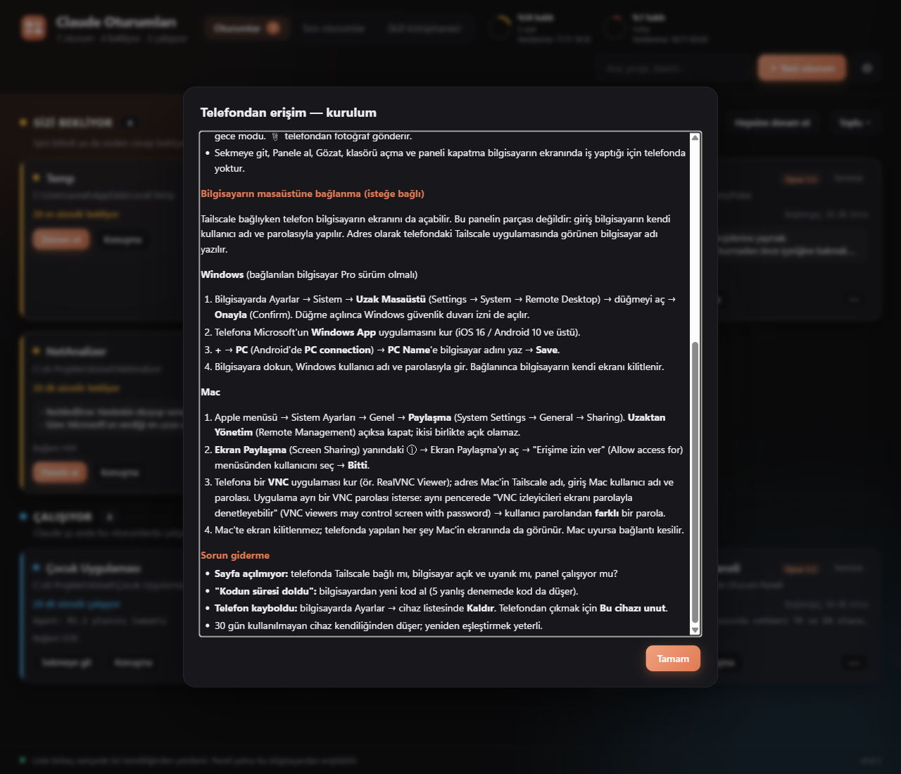
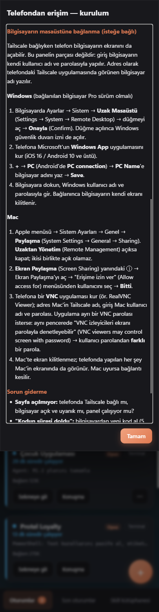
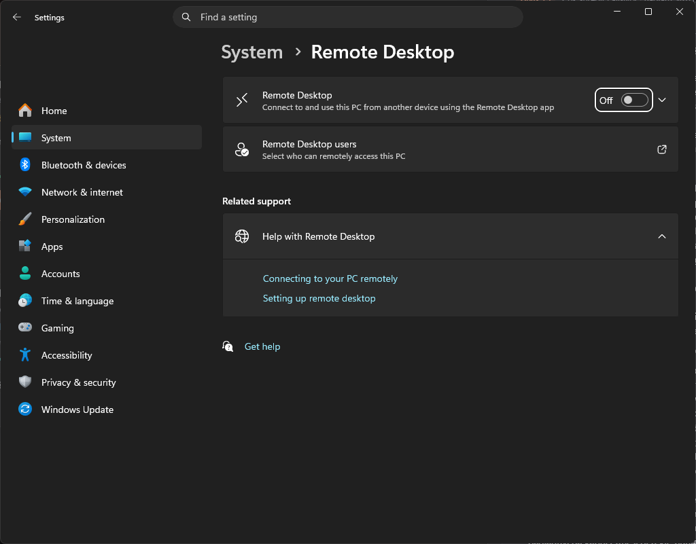

# Telefondan bilgisayarın masaüstüne bağlanma (Windows ve Mac)

Sürüm 1.0.0 · 2026-11-17 · Claude Oturum Paneli 0.8.3 ile birlikte

Panelin telefondan erişimi için kurulan **Tailscale**, telefonu bilgisayara şifreli özel bir ağla bağlar
(kurulum: panelde Ayarlar → Telefondan erişim → **Nasıl kurulur?**). Aynı bağlantı üzerinden telefon
bilgisayarın **ekranını** da açabilir. Bu panelin bir özelliği değildir: işi işletim sisteminin kendi uzak
masaüstü hizmeti yapar, giriş bilgisayarın kendi kullanıcı adı ve parolasıyla olur. İnternete port açılmaz;
bağlantı yalnız aynı Tailscale hesabındaki cihazlar arasındadır.

Panel içindeki rehberde aynı adımların kısa hâli var:

---

## 1. Windows

Kaynak: [1], [2].

**Gereken:** bağlanılan bilgisayar **Windows 11 Pro** (veya Pro/Enterprise) olmalı; Home sürümüne bağlanılamaz [2].
Telefon iOS/iPadOS 16 veya Android 10 ve üstü [1].

1. Bilgisayarda **Settings → System → Remote Desktop** (Ayarlar → Sistem → Uzak Masaüstü) [2].
   Ekranda **Off** yazıyorsa düğmeyi aç ve **Confirm** (Onayla) de. Düğme açılınca Windows güvenlik
   duvarındaki Uzak Masaüstü kuralları da açılır.

   

   *Görüntü bu geliştirme bilgisayarından alındı (17.11.2026); kişisel bilgiler kapatıldı. Düğme burada kapalı.*

2. Telefona Microsoft'un **Windows App** uygulamasını kur (App Store / Google Play) [1].
   Eski adıyla "Remote Desktop" uygulamasının yerini aldı [1].
3. **iPhone/iPad:** sekmelerden birinde **+** → **PC** → **PC Name** alanına bilgisayarın adını yaz → **Save** [1].
   **Android:** **+** → **PC connection** → **PC Name** → **Save** [1].
   Bilgisayar adı olarak telefondaki **Tailscale** uygulamasında görünen adı yaz (örn. `masaustu-pc`);
   Tailscale bu adı kendi ağında çözer.
4. **Devices** sekmesinde bilgisayara dokun. Kullanıcı hesabı eklemediysen sorulur: Windows kullanıcı adı ve
   parolası [1]. Android'de ilk bağlantıda güven sorusu çıkar → **Connect** [1].
5. Bağlanınca bilgisayarın kendi ekranı kilitlenir; bilgisayarın başına dönünce parolayla yeniden açılır.
   *(Saha tespiti; kaynak belgede bu davranış yazmıyor.)*

**Bağlanamıyorsa**
- Tailscale telefonda bağlı mı, bilgisayar açık ve uyanık mı?
- Settings → System → Remote Desktop **On** mu? Bu geliştirme bilgisayarında kayıt defteri "açık" gösterirken
  ayar sayfası **Off** ve güvenlik duvarındaki üç "Remote Desktop" kuralı kapalıydı (saha tespiti, 17.11.2026).
  Ayar sayfasındaki düğme esastır.
- Şirket bilgisayarında bu ayar yönetici politikasıyla kapatılmış olabilir; o durumda BT ekibine sorulur.

---

## 2. Mac

Kaynak: [3], [4].

1. **Apple menüsü → System Settings → General → Sharing** (Sistem Ayarları → Genel → Paylaşma) [3].
2. **Remote Management** (Uzaktan Yönetim) açıksa kapat: "You can't have both Screen Sharing and Remote
   Management on at the same time." [3]
3. **Screen Sharing** (Ekran Paylaşma) yanındaki ⓘ düğmesi → Screen Sharing'i aç [3].
4. **Allow access for** menüsünden **All users** ya da **Only these users** (kendi kullanıcını ekle) → **Done** [3].
5. Telefona bir **VNC** uygulaması kur (örn. RealVNC Viewer, Screens). Adres: Mac'in Tailscale uygulamasında
   görünen adı. Giriş: Mac kullanıcı adı ve parolası.
6. Uygulama ayrıca bir VNC parolası isterse: aynı pencerede **VNC viewers may control screen with password**
   seçeneğini aç ve parola belirle [3]. Apple'ın uyarısı: bu parola Mac'teki bir kullanıcının parolası
   olmamalı; ayrıca üçüncü taraf VNC uygulamaları tuş vuruşlarını şifrelemeyebilir [4]. Bağlantı Tailscale
   içinden geçtiği için ağ tarafı zaten şifrelidir.

**Windows'tan farklar**
- Mac'in ekranı kilitlenmez: telefonda yapılan her şey Mac'in kendi ekranında da görünür.
- Mac uyursa bağlantı kesilir. Masaüstü Mac'te uyku ayarı kapatılarak, dizüstünde kapak açık tutularak çözülür.
- Telefonda Windows App kullanılamaz; VNC uygulaması gerekir.
- Bu adımlar gerçek bir Mac'te henüz denenmedi (bkz. `MAC_TEST.md`). Türkçe menü adları macOS'un Türkçe
  arayüzünde farklı yazılmış olabilir; parantez içindeki İngilizce adlar Apple belgesindeki adlardır.

---

## 3. Başka programlar

Tailscale bağlantısı yalnız panele değil bilgisayarın tamamına açılır. Bilgisayarda ağdan bağlantı kabul eden
her program (web arayüzü, dosya paylaşımı vb.) telefondan aynı adla açılabilir. Bu programlara giriş panelin
eşleştirmesiyle değil, programın kendi parolasıyla korunur. Yalnız `127.0.0.1`'i dinleyen programlar
(panelin kendisi dahil) telefondan doğrudan açılmaz; panel bunun için Tailscale Serve kullanır.

---

## Kaynakça

1. Microsoft Learn, "Connect to Windows devices and apps with Windows App", güncelleme 04.11.2026.
   https://learn.microsoft.com/en-us/windows-app/get-started-connect-devices-desktops-apps
2. Microsoft Support, "How to use Remote Desktop".
   https://support.microsoft.com/en-us/windows/experience/connectivity-networking/how-to-use-remote-desktop
3. Apple Support, Mac User Guide, "Turn Mac screen sharing on or off".
   https://support.apple.com/guide/mac-help/turn-screen-sharing-on-or-off-mh11848/mac
4. Apple Support, Remote Desktop User Guide, "Virtual Network Computing access and control with Remote Desktop".
   https://support.apple.com/guide/remote-desktop/virtual-network-computing-access-and-control-apde0dd523e/mac

Bağlantılar 17.11.2026 tarihinde okunmuştur.

---

# Ek — Sürüm geçmişi

| Sürüm | Tarih | Değişen alan | Eski değer | Yeni değer | Neden |
|---|---|---|---|---|---|
| 1.0.0 | 2026-11-17 | Belgenin tamamı | — | İlk sürümlü yayın | Kullanıcı: "nasıl yapılır ekleyelim mutlaka", "ss'li olursa daha iyi olur" |
